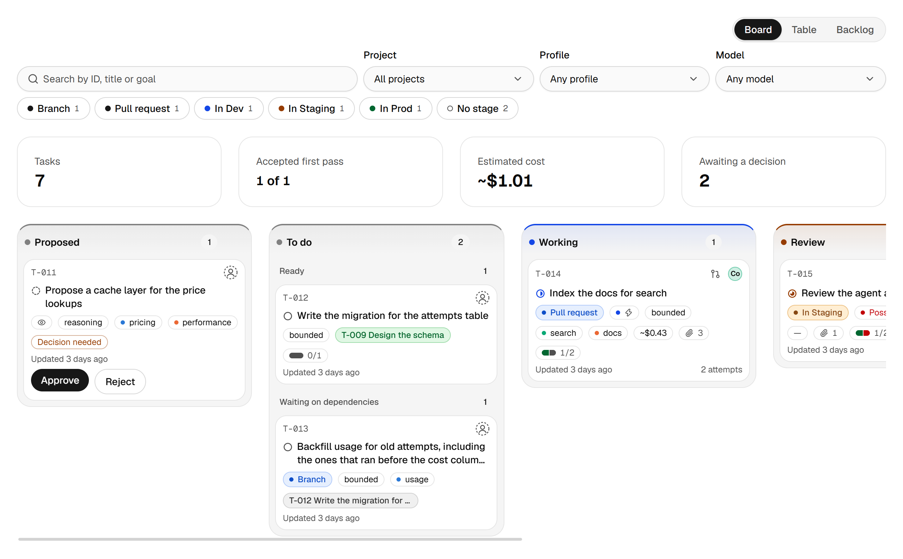

# Eskais UI

Agent-native React components on [Vercel UI SDK](https://ui-sdk.dev), shipped as a shadcn registry: people and their agents operate the same accessible UI.

[](https://github.com/p-otero/eskais-ui/actions/workflows/ci.yml?query=branch%3Amain)
[](https://github.com/p-otero/eskais-ui/releases)
[](LICENSE)

**[Live docs and demos](https://p-otero.github.io/eskais-ui/)** · [Components](https://p-otero.github.io/eskais-ui/docs/components/) · [Installation](https://p-otero.github.io/eskais-ui/docs/installation/) · [Changelog](CHANGELOG.md)



## What it is

- **Built on UI SDK.** Behaviour, focus, keyboard and ARIA come from `@ui-sdk/react`; Eskais UI adds styles, semantic tokens, themes and composed components (a task board, data tables, an editor, app layouts). Every operable control is a UI SDK part, so nothing is invisible to an agent.
- **Agents operate it, people approve.** `createAgent` reads the page by accessible names and acts on it. Destructive actions carry `data-agent-confirm` and wait for a person; tests cover the refused and approved paths.
- **Accessibility checked in CI.** axe and pixel contrast in Chrome, in the default and compact themes, light and dark, and every colour palette; 44px touch targets and no zoom-on-focus on phones.
- **Installs clean.** CI adds every item to a fresh npm app and a fresh pnpm app (no Bun), and every pinned dependency is at least 7 days old, for package managers that hold back young releases. Registry code imports nothing from Node or Bun.
- **React Compiler-clean and fast by default.** The showcase builds with `babel-plugin-react-compiler` and runs the browser checks on it; long lists and tables virtualize past 200 rows and stay reachable by keyboard, agents and find in page.
- **One design system.** Spacing, type, elevation, tone and motion are role tokens; compact, glass and colour palettes are runtime attributes, not reinstalls.

## Quick start

Add the registry to `components.json` (from `npx shadcn@latest init`):

```json
{
  "registries": {
    "@eskais": "https://raw.githubusercontent.com/p-otero/eskais-ui/refs/tags/v0.2.10/public/r/{name}.json"
  }
}
```

Put `@layer ui-sdk;` first in your global CSS, above `@import "tailwindcss"`, then add components:

```bash
npx shadcn@latest add @eskais/theme @eskais/font-geist @eskais/agent-task-board
```

The [installation guide](https://p-otero.github.io/eskais-ui/docs/installation/) covers aliases and subpath imports, `utils`, fonts, the appearance setup and known shadcn caveats; [Theming](https://p-otero.github.io/eskais-ui/docs/theming/) covers seed tokens, palettes, compact and glass; [Agents](https://p-otero.github.io/eskais-ui/docs/agents/) covers the agent bridge. Requires React 19, Tailwind CSS v4 and Node with npm or pnpm.

## Status

Version **0.2.10**. Before 1.0 a minor version can break compatibility. UI SDK is in beta and pinned to an exact version (`0.1.0-beta.12`); see the [changelog](CHANGELOG.md) and [releases](https://github.com/p-otero/eskais-ui/releases). The URL above pins a release through `refs/tags/`; change the tag to upgrade.

## Highlights

The [full catalog](https://p-otero.github.io/eskais-ui/docs/components/) has 140+ registry items, each with a live demo, its API and the actions an agent can take.

- **Agent work:** [agent-task-board](https://p-otero.github.io/eskais-ui/docs/components/agent-task-board/), [task-card](https://p-otero.github.io/eskais-ui/docs/components/task-card/), [attempt-timeline](https://p-otero.github.io/eskais-ui/docs/components/attempt-timeline/), [usage](https://p-otero.github.io/eskais-ui/docs/components/usage/), [proposal-actions](https://p-otero.github.io/eskais-ui/docs/components/proposal-actions/), [inbox](https://p-otero.github.io/eskais-ui/docs/components/inbox/)
- **Data:** [server-data-table](https://p-otero.github.io/eskais-ui/docs/components/server-data-table/), [data-table](https://p-otero.github.io/eskais-ui/docs/components/data-table/), [filter-panel](https://p-otero.github.io/eskais-ui/docs/components/filter-panel/), [chart](https://p-otero.github.io/eskais-ui/docs/components/chart/), and the [server data guide](https://p-otero.github.io/eskais-ui/docs/server-data/)
- **Layout blocks:** [shell](https://p-otero.github.io/eskais-ui/docs/components/shell/), [master-detail](https://p-otero.github.io/eskais-ui/docs/components/master-detail/), [dashboard-grid](https://p-otero.github.io/eskais-ui/docs/components/dashboard-grid/), [settings-page](https://p-otero.github.io/eskais-ui/docs/components/settings-page/), [document-workspace](https://p-otero.github.io/eskais-ui/docs/components/document-workspace/)
- **Editing and forms:** [markdown-editor](https://p-otero.github.io/eskais-ui/docs/components/markdown-editor/), [form](https://p-otero.github.io/eskais-ui/docs/components/form/), [command](https://p-otero.github.io/eskais-ui/docs/components/command/), [confirm-dialog](https://p-otero.github.io/eskais-ui/docs/components/confirm-dialog/)

## Built with agents

This repository is designed to be developed by coding agents. [AGENTS.md](AGENTS.md) holds the design-system rules (spacing and type roles, elevation, tone, icons, touch targets, accessibility) that lint rules and tests enforce, and the same conventions ship to consumers as [agent skills](https://p-otero.github.io/eskais-ui/docs/agent-skills/) installed with Vercel's [skills CLI](https://github.com/vercel-labs/skills) (`npx skills add p-otero/eskais-ui@<tag> --full-depth`) or shadcn.

## Develop

```bash
bun install
bun run dev        # showcase
bun run dev:site   # docs site
bun run verify     # lint, format check, typecheck, tests, registry build
```

See [AGENTS.md](AGENTS.md) for conventions and [docs/research](docs/research) for the decisions behind the design. `node tooling/readme-screenshots.mjs` regenerates the image above after `bun run build:showcase`.

## License

[MIT](LICENSE)
