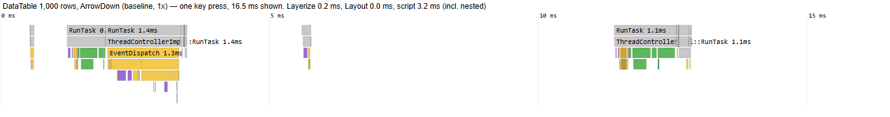
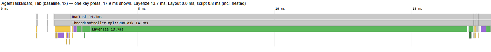
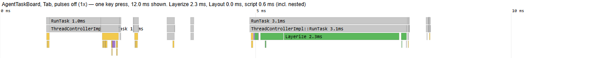
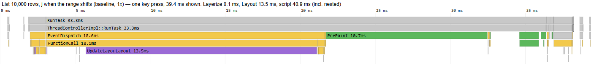

# Navigation and keyboard performance: baseline, bottlenecks and plan

Eskais UI 0.2.0 (`origin/main` 8d0022b), UI SDK 0.1.0-beta.5, React 19.3.1, Chrome 157, measured 2026-11-17 with
`bun run perf` (`tooling/perf/`). Goal: keyboard and navigation that feel GPUI-class, allowing for the DOM.

**Status.** §0–§9 are the research as written on 2026-11-17. The plan is being implemented on the rebased `main`
(ff95ccd, 2026-11-18): §10 has the rebased baseline, what changed in it, and each step's before/after numbers.

## 0. Summary

**Where it already is.** Menus, command arrows, sidebar, calendar and plain typing cost ≤ 2.2 ms of main-thread
work per key press at 1× and re-render zero to two components. Overlays paint their content on the next frame
(~15 ms at 1×). Roving focus re-renders only the two rows whose state changes in List and the board table.

**Where it isn't.** At 4× CPU throttling, every collection that scrolls or holds many rows falls behind. With an
arrow key held down, the List, DataTable, board and board table lag 1–3 s and drop 50–200 frames. A single press
reaches a p95 of 60–270 ms. There are seven causes, all in Eskais code or in how Eskais uses UI SDK:

1. **Infinite `animate-ping` pulses on the board.** 28 running pulses make every repaint pay ~15 ms of `Layerize`.
   Injecting `animation: none` takes Tab from 18.3 to 4.4 ms of main thread per press at 1×, and the 4× p95 from 235
   to 27 ms.
2. **DataTable re-renders the whole window on every scroll step:** 1,125 component renders per ↓ press (733 with
   React Compiler).
3. **The 10k virtualized list keeps 10,000 find-in-page stubs in the DOM.** When the range shifts, a press costs
   13.5 ms of forced layout inside the key handler plus 10.7 ms of PrePaint. It takes 545 ms to mount.
4. **Roving focus fans out to every row.** Eskais's `row-navigation` runs every row's `attrs` on each move, even
   though only two rows re-render. **Prototyped (§6):** about −45% script per move on a 1,000-row list (1.7 →
   0.95 ms at 1×), and about half the p50 and p95 at 4×.
5. **Rows repaint more than they need.** On a held key at 4×, paint is the largest cost of the 1,000-row list.
   `contain: layout paint style` on rows cut it from 659 to 159 ms over the 2 s run.
6. **Rows are heavy.** A 1,000-row List mounts 31,012 components and 54 MB of JS heap: a tooltip, a button with
   hidden spinners and a fast-link controller per row.
7. **Navigation leaves time on the table.** The docs sidebar never follows on press, because `onClick` routing
   disables fast-link. Cold routes take 428 ms against 120 ms warm, with no prefetch.

UI SDK's own filtering in Command and Combobox is the remaining hot spot: 3.4–3.7 ms of script per keystroke at
1×, and a p95 of 140–230 ms at 4×. It goes upstream (§8).

**Plan (§5)** in thirteen shippable steps:

- the prototype and quick fixes: row narrowing, a CI check, no pulses in collections, memoized table rows, row
  containment;
- then lighter rows, no forced layout in Tabs, fewer find-in-page stubs;
- then a virtualizer that renders only when its range changes;
- then navigation: press routing and prefetch;
- then the palette, glass, and the keyboard models that don't exist yet (Linear-style board, table cells).

**Budgets (§7)** turn renders per press, layer counts, forced layouts and bundle size into exact CI checks.

## 1. How it is measured

`bun run perf` (`tooling/perf/run.mjs`) builds the showcase twice, normally and with React Compiler
(`REACT_COMPILER=1`, `apps/showcase/react-compiler.ts`), into `tooling/perf/.builds/`. It serves each build and
drives system Chrome through Playwright and CDP. Fixtures are `?demo=perf&scenario=<name>`
(`apps/showcase/src/perf/`). It prints tables, writes `tooling/perf/results/<name>.json`, and saves one Chrome
trace per scenario to `results/traces/*.json` (open them in DevTools → Performance → Load profile).

| Probe                 | How                                                                                                                                                                                                                                                                                                                                                                        | Notes                                                                                                                                            |
| --------------------- | -------------------------------------------------------------------------------------------------------------------------------------------------------------------------------------------------------------------------------------------------------------------------------------------------------------------------------------------------------------------------- | ------------------------------------------------------------------------------------------------------------------------------------------------ |
| Key to next paint     | a capture `keydown` listener schedules `requestAnimationFrame` → `MessageChannel`; the message runs once that frame has painted. Presses are sent one at a time, each after the previous one painted                                                                                                                                                                       | p50/p95/max. Includes the wait for the next vsync (0–16.7 ms at 60 Hz), so ~2–6 ms p50 and ~8 ms p95 is the floor for a press that costs nothing |
| Event Timing          | `PerformanceObserver({ type: "event", durationThreshold: 16 })`                                                                                                                                                                                                                                                                                                            | INP-style, 8 ms granularity, only entries ≥ 16 ms                                                                                                |
| Renders per press     | a `__REACT_DEVTOOLS_GLOBAL_HOOK__`, installed before React, counts per commit the function, class, forwardRef and memo fibers with the `PerformedWork` flag. It descends only where React cloned the child list, as React DevTools does. Works in production builds; the perf builds keep function names (`SHOWCASE_KEEP_NAMES=1`) so renders are attributed to components |                                                                                                                                                  |
| Main thread per press | a CDP trace (`devtools.timeline`, `toplevel`, `v8.execute`) of the first 20 presses at 1×. Self time on `CrRendererMain` is bucketed as script, style, layout, paint (PrePaint, Paint, Layerize, Commit), gc or other, then divided by presses                                                                                                                             | latency comes from the untraced run                                                                                                              |
| Forced layout         | a `Layout` or `UpdateLayoutTree` nested inside script                                                                                                                                                                                                                                                                                                                      | ~1 per press is the browser scrolling the newly focused element into view inside the key event; more is layout thrash                            |
| Long tasks            | `longtask` and `long-animation-frame` observers                                                                                                                                                                                                                                                                                                                            |                                                                                                                                                  |
| Held key              | CDP `Input.dispatchKeyEvent` with `autoRepeat` every 33 ms for 2 s, without waiting for paint; frames counted with `requestAnimationFrame`                                                                                                                                                                                                                                 | dropped frames = expected 60 Hz frames − rAF callbacks; p95 is lag behind the key                                                                |
| Overlays              | trigger focused, Enter opens, Escape closes. Records the first painted frame with the content box visible, and when its animations finish or it leaves the DOM                                                                                                                                                                                                             | median of 5                                                                                                                                      |
| Mount                 | fixture module evaluation to its first paint; JS heap after a forced GC                                                                                                                                                                                                                                                                                                    | median of 3; `empty` is the floor                                                                                                                |
| Site navigation       | built site under `/eskais-ui/`. A sidebar link is pressed like a person: pointerdown, 90 ms, pointerup. Measures pointerdown to the new `h1` painted and to no Suspense fallback left. Variants: fast links on or off (`data-no-fast-link` on `<body>`); cold route, or warm (visited before, the upper bound of prefetching); no throttling, or 150 ms RTT at 9 Mbps      | median of 6 routes                                                                                                                               |
| Bundle                | each registry item re-exported from one entry and built with Vite (minified, React external): gzip of the initial chunks, of lazy chunks, and the share that goes away when `@ui-sdk/*` is external                                                                                                                                                                        | `node tooling/perf/bundle.mjs [items…]`                                                                                                          |

Other tools:

- `node tooling/perf/layers.mjs <scenario> [build] [--glass] [--css=…]` counts composited layers and their reasons.
- `--experiments` runs scenarios that inject a CSS change.
- `--builds=normal@before,normal@after --repeat=3` alternates two builds of different sources, so noise hits
  both alike.
- `node tooling/perf/trace-chart.mjs <trace> <png>` draws one press as a flame chart.

Machine: Windows 11, Chrome 157.0.8103.79 headless at 1280×900 and DPR 1. CPU throttling is
`Emulation.setCPUThrottlingRate` at 1× and 4×. **Single runs at 4× vary by ±50% on this machine**, so compare
counts, main-thread time and A/B repeats rather than one p95.

## 2. Baseline

These are the 2026-11-17 numbers on 8d0022b. The rebased baseline (2026-11-18) replaced them in
`docs/perf/baseline.json`; §10.1 compares the two.

### 2.1 Key presses

Times are in ms. "Main thread" is the self time per press at 1×, all kinds summed.

| Scenario                             | p50 / p95, 1×   | p95, 4× | p95, 4×, compiler | Renders per press (compiler)      | Main thread, 1× | Forced layouts |
| ------------------------------------ | --------------- | ------- | ----------------- | --------------------------------- | --------------- | -------------- |
| List, 1,000 rows (j/k)               | 6.4 / 11.5      | 187.1   | 49.5              | 10 (10)                           | 5.4             | 1.05           |
| List, 10,000 rows virtualized (j/k)  | 23.5 / 36.7     | 211.1   | 230.5             | 48 (35)                           | 15.6            | 2              |
| DataTable, 1,000 rows (↓/↑)          | 12.4 / 19.9     | 111.1   | 114.9             | **1,125 (733)**                   | 9.7             | 3.55           |
| Command, 300 items (typing)          | 6.2 / 10.5      | 212.9   | 71                | 1 (1)                             | 5.1             | 3.15           |
| Command, 300 items (↓)               | 1.6 / 8.4       | 50.9    | 11.1              | 0 (0)                             | 1.6             | 1              |
| Dropdown menu, 24 items (↓)          | 2.3 / 7.3       | 62.8    | 11.2              | 0 (0)                             | 2.2             | 3.05           |
| Tabs, 12 tabs with panels (→)        | 8 / 12.3        | 139.1   | 38.1              | 4 (4)                             | 5.8             | **7.05**       |
| Sidebar, 60 links (Tab)              | 1.5 / 7.9       | 14.3    | 13.1              | 0 (0)                             | 1.9             | 1.05           |
| AgentTaskBoard, 200 cards (Tab)      | **23.2 / 31.3** | 231.7   | 273.5             | 0 (0)                             | **18.2**        | 2.35           |
| AgentTaskBoard, glass theme (Tab)    | 6.1 / 10.5      | 113.9   | 33.7              | 0 (0)                             | 4.6             | 2.35           |
| AgentTaskBoard table, 200 rows (j/k) | 7.3 / 14.5      | 65      | 67.1              | 4 (4)                             | 7.3             | 3.05           |
| Calendar, 2 months (arrows)          | 3.3 / 8.8       | 16.9    | 16.2              | 2 (2); 187 when the month changes | 2.2             | 1.85           |
| Input (typing)                       | 1.8 / 7.1       | 9.9     | 13.6              | 0 (0)                             | 3.4             | 1.1            |
| Combobox, 200 options (typing)       | 3.1 / 27.4      | 143.5   | 231               | 1 (1); 402 on the first key       | 7.0             | 5.24           |
| MarkdownEditor, 40 sections (typing) | 3.6 / 5.7       | 20.8    | 17.3              | 0 (0)                             | 5.4             | 2.2            |

Main thread per press at 1×, normal build, by kind (ms):

| Scenario        | Script   | Style | Layout   | Paint     | GC   | Other |
| --------------- | -------- | ----- | -------- | --------- | ---- | ----- |
| list-1k         | 2.14     | 0.12  | 0        | 1.87      | 0.3  | 0.94  |
| list-10k        | 2.17     | 0.66  | **5.19** | **6**     | 0    | 1.57  |
| table           | 2.61     | 0.83  | 0.17     | 3.38      | 0.58 | 2.16  |
| command:type    | **3.37** | 0.14  | 0.14     | 0.45      | 0.09 | 0.87  |
| command:arrows  | 0.58     | 0.04  | 0        | 0.45      | 0    | 0.52  |
| menu            | 0.73     | 0.19  | 0        | 0.52      | 0    | 0.79  |
| tabs            | 1.92     | 1.01  | 0.47     | 1.04      | 0.22 | 1.15  |
| sidebar         | 0.45     | 0.07  | 0        | 0.74      | 0    | 0.59  |
| board           | 0.51     | 0.59  | 0.03     | **16.23** | 0    | 0.88  |
| board:glass     | 0.66     | 0.5   | 0.04     | 2.3       | 0    | 1.06  |
| board-table     | 1.75     | 0.09  | 0        | 4.14      | 0    | 1.32  |
| calendar        | 1.03     | 0.06  | 0        | 0.26      | 0.26 | 0.62  |
| typing:input    | 1.15     | 0.01  | 0.16     | 0.58      | 0    | 1.5   |
| typing:combobox | **3.7**  | 0.58  | 0.45     | 0.81      | 0    | 1.5   |
| typing:markdown | 2.6      | 0.11  | 0.2      | 0.63      | 0.56 | 1.29  |

Which components render per press:

| Scenario     | Components (per press)                                                                 |
| ------------ | -------------------------------------------------------------------------------------- |
| list-1k      | TooltipTrigger ×4, NavigableRowPart ×2, Connected ×2, Button ×2: two rows              |
| list-10k     | the two rows, plus rows entering the range and GapFindStubs ×2.3                       |
| table        | TableCell ×205, Checkbox ×127, CheckboxIndicator ×84, TableRow ×42: every rendered row |
| command:type | CommandItem ×18                                                                        |
| combobox     | ComboboxItem ×59                                                                       |
| tabs         | TabsTab ×3.7, TabsPanel ×2                                                             |
| calendar     | CalendarDay ×9 on average: the whole grid when the month changes                       |

### 2.2 Held key (30 Hz autorepeat, 2 s)

Each cell gives lag p95 in ms / dropped frames, plus long tasks at 4×.

| Scenario       | 1×          | 4×                  | 4×, compiler |
| -------------- | ----------- | ------------------- | ------------ |
| list-1k        | 11.6 / 0    | **3,294 / 204** / 9 | 3,232 / 194  |
| list-10k       | **920** / 0 | 2,209 / 133 / 3     | 3,130 / 188  |
| table          | 28.6 / 0    | 2,065 / 105 / 14    | 1,463 / 45   |
| command:arrows | 9 / 0       | 47.6 / 0 / 0        | 10.5 / 0     |
| menu           | 7.7 / 0     | 32.1 / 0 / 1        | 10.1 / 0     |
| tabs           | 8.5 / 0     | 769 / 54 / 7        | 166 / 0      |
| sidebar        | 8.8 / 0     | 13 / 0 / 0          | 12.3 / 0     |
| board          | 58.5 / 0    | 2,202 / 122 / 16    | 2,052 / 114  |
| board-table    | 16.7 / 0    | 1,971 / 81 / 2      | 1,100 / 78   |
| calendar       | 9.1 / 0     | 124 / 0 / 1         | 128 / 0      |

A lag in seconds means each repeat costs more than the 33 ms between repeats, so the queue grows for the whole
2 s. That is what "the list keeps scrolling after I let go" feels like.

### 2.3 Overlays

Median of 5, normal build, in ms from the key press.

| Overlay         | CPU | First frame with content | Open animation done | Close done |
| --------------- | --- | ------------------------ | ------------------- | ---------- |
| dialog          | 1×  | 15.6                     | 216                 | 230        |
| popover         | 1×  | 15.1                     | 157                 | 172        |
| menu            | 1×  | 16.9                     | 159                 | 172        |
| command palette | 1×  | **44.8**                 | 256                 | 234        |
| drawer          | 1×  | 14.9                     | **506**             | **521**    |
| dialog          | 4×  | 28                       | 232                 | 238        |
| popover         | 4×  | 22.3                     | 165                 | 177        |
| menu            | 4×  | 33.1                     | 178                 | 178        |
| command palette | 4×  | **282**                  | 503                 | 381        |
| drawer          | 4×  | 29.7                     | 516                 | 519        |

The compiler build is within ±10%. Content lands on the next frame except in the command palette, which mounts
300 items on open. The drawer takes ~500 ms to settle, against 200 ms for Dialog; the cause is UI SDK's drawer
transition, not traced yet.

### 2.4 Mount

| Fixture                          | Mount, 1× (ms) | Mount, 4× (ms) | Heap (MB) | Components | Compiler: ms / components |
| -------------------------------- | -------------- | -------------- | --------- | ---------- | ------------------------- |
| empty                            | 14             | 105            | 7.9       | 4          | 14 / 4                    |
| list-1k                          | 358            | 3,720          | **54.3**  | **31,012** | 287 / 18,012              |
| list-10k (virtualized)           | **545**        | 5,130          | 14.7      | 954        | 523 / 655                 |
| table (1,000 rows, virtualized)  | 116            | 1,140          | 10.8      | 1,659      | 112 / 1,283               |
| board (200 cards)                | 357            | 2,601          | 20.1      | 7,299      | 325 / 4,659               |
| board-table (200 rows)           | 370            | 2,308          | 17.9      | 8,884      | 356 / 8,009               |
| command (300 items)              | 102            | 659            | 12.6      | 1,296      | 93 / 1,296                |
| typing (input, combobox, editor) | 91             | 470            | 10.0      | 106        | 74 / 96                   |

### 2.5 Site navigation

Docs sidebar link, pointerdown to paint, median of 6 routes, in ms.

| Network    | Fast links | Route             | Heading painted | Page complete | Complete, max |
| ---------- | ---------- | ----------------- | --------------- | ------------- | ------------- |
| none       | on         | cold              | 125             | **428**       | 449           |
| none       | on         | warm (prefetched) | 120             | **120**       | 131           |
| none       | off        | cold              | 121             | 421           | 444           |
| none       | off        | warm              | 121             | 121           | 135           |
| 150 ms RTT | on         | cold              | 128             | 433           | **715**       |
| 150 ms RTT | on         | warm              | 133             | 133           | 135           |
| 150 ms RTT | off        | cold              | 133             | 432           | 717           |
| 150 ms RTT | off        | warm              | 120             | 120           | 141           |

- **Fast links on and off are the same.** The sidebar's links use `linkTo` (`apps/site/src/router.tsx`), which
  passes `onClick`, and `Link` disables fast-link whenever `onClick` or `render` is set (`registry/ui/link.tsx:109`).
  Every docs navigation waits for the full 90 ms press.
- **A cold route loads 14 chunks** after the press (the item's examples, `virtual-rows`, `data-table-*`…), and
  completes ~300 ms after a warm one.
- The network profile only shows in the max; route chunks are small and fetched in parallel.

### 2.6 Bundle

Gzip KB per item with everything it imports, React excluded; 113 items in all, in
`docs/perf/baseline.json` → `bundles`. The median item is 28.6 KB.

| Item             | Initial | Lazy | UI SDK (share) |
| ---------------- | ------- | ---- | -------------- |
| markdown-editor  | 227.4   | 70.4 | 71.1 (31%)     |
| agent-task-board | 192.5   | 1.2  | 114.1 (59%)    |
| chart            | 118.3   | 0    | 17.7 (15%)     |
| list-item        | 82.3    | 0    | 51.9 (63%)     |
| sidebar          | 79.0    | 0    | 57.8 (73%)     |
| combobox         | 72.7    | 14.9 | 58.2 (80%)     |
| command          | 66.2    | 14.5 | 49.1 (74%)     |
| data-table       | 65.0    | 0.6  | 30.6 (47%)     |
| dropdown-menu    | 55.9    | 15.5 | 42.2 (76%)     |
| dialog           | 44.6    | 15.0 | 31.9 (72%)     |
| tooltip          | 43.0    | 0    | 32.5 (75%)     |
| tabs             | 39.7    | 0.6  | 22.9 (58%)     |
| calendar         | 34.8    | 0    | 21.3 (61%)     |
| button           | 29.8    | 0.6  | 12.5 (42%)     |
| link             | 23.4    | 0    | 8.7 (37%)      |
| virtual-rows     | 13.0    | 0    | 0              |
| row-navigation   | 11.8    | 0    | 10.4 (88%)     |

Shared code counts in each row, so the sizes don't add up. They are what an app pays for adding that one item.

### 2.7 Against the GPUI-class targets

| Target                                                                   | Met by                                                                                   | Missed by                                                                                  |
| ------------------------------------------------------------------------ | ---------------------------------------------------------------------------------------- | ------------------------------------------------------------------------------------------ |
| ≤ 8 ms main thread per press at 1×                                       | list-1k (5.4), command, menu, tabs (5.8), sidebar, calendar, board table (7.3), typing   | **board 18.2, list-10k 15.6, table 9.7**                                                   |
| p95 < 16 ms at 4×                                                        | sidebar, calendar (16.9, at the edge), input; with the compiler, command arrows and menu | every collection, tabs, typing in filters                                                  |
| Zero re-renders outside the two rows                                     | List, board table, menu and command arrows (0), sidebar (0), calendar within a month     | **table (1,125)**, list-10k (48), tabs (4: tab and panel ×2), calendar across months (187) |
| No layout thrash (≤ 1 forced layout, the browser's own scroll into view) | list-1k, sidebar, command arrows, input                                                  | **tabs 7**, combobox 5.2, table 3.6, menu 3, board table 3, list-10k 2 (4.4 ms)            |
| Overlays show content on the next frame                                  | dialog, popover, menu, drawer                                                            | **command palette** (45 ms at 1×, 282 ms at 4×)                                            |

## 3. Bottlenecks, with evidence

Traces are in `tooling/perf/results/traces/` (not committed: 2–8 MB each); the charts in `docs/perf/img/` are one
press drawn from them.

**B1. DataTable re-renders every rendered row on every move.** 1,125 component renders per ↓ (TableCell ×205,
Checkbox ×127, CheckboxIndicator ×84…); 733 with the compiler. Held ↓ at 4×: 2.1 s of lag, 105 dropped frames.

- Each move calls `scrollIntoView`. TanStack's `useVirtualizer` re-renders its host on every scroll event, even
  when the range is unchanged.
- `DataTable` maps the window into `DataTableRow`s that aren't memoized and get a new `selection` object and
  closures each render (`registry/ui/data-table.tsx:214-242`).
- The compiler can't help: it skips `useVirtualRows` (the `IncompatibleLibrary` entry in
  `apps/showcase/react-compiler.ts`), and memoizing the parent doesn't stop the children of a re-run `map`.



**B2. Roving focus does O(rows) work per move.** The React adapter (`@ui-sdk/react/use-primitive.js`,
`usePartState`) runs a `check` for every subscribed part on each store change: it recomputes the part's `attrs` and
compares. `row-navigation`'s row slot reads `state.active` in `attrs` and has no `selects`, so every move recomputes
1,000 rows' attributes (and allocates them) to re-render two. UI SDK's own Tabs, Menu and Listbox narrow with
`selects()`, which is why menu and command arrows cost nothing. **Prototyped (§6):** script per move on list-1k
went from 1.55–1.86 ms to 0.82–1.04 ms.

**B3. The board pays ~15 ms of `Layerize` on every repaint.** It has 28 running `animate-ping` pulses: liveness
dots in `task-card-chips.tsx:95` and `StatusDot pulse` in `status-pill.tsx:43`. A running transform animation makes
Chrome assume it overlaps everything painted after it, so 83 more elements are promoted ("Overlaps other composited
content").

- Layers: 127 with the pulses, 81 with an opacity-only pulse, 16 with no pulse (`layers.mjs board`).
- Moving focus with Tab repaints, so every press pays it.

Experiment, same build, pulses changed by injected CSS (`--experiments`, `docs/perf/prototype-ab.json` →
`pulseExperiments`):

| Board, Tab            | Main thread per press, 1× | p50 / p95, 1×  | p50 / p95, 4× |
| --------------------- | ------------------------- | -------------- | ------------- |
| as shipped            | 18.3 ms (paint 16.4)      | 21.8 / 42      | 97 / 236      |
| pulse as opacity only | 14.6 ms (paint 12.5)      | 14.1 / 17.9    | 85 / 254      |
| no pulse              | **4.4 ms (paint 2.9)**    | **5.0 / 10.7** | **18 / 27**   |

The glass theme also measured fast (4.6 ms). Its `backdrop-filter` makes every card its own layer, so the pulses no
longer promote their neighbours. Its cost moves to the GPU (126 backdrop layers, 12 Mpx), which this harness doesn't
measure (step 12).




**B4. The 10k virtualized list is held down by its find-in-page stubs.** `GapFindStubs` renders one
`hidden="until-found"` element per unrendered row, so 10,000 extra positioned elements are in the DOM
(`virtual-rows.tsx:192-247`).

- Averaged over presses: 5.2 ms of layout, 6 ms of paint, and 2 forced layouts taking 4.4 ms (the virtualizer
  measuring rows, `scrollParentOf` reading computed style), plus 48 renders as rows enter the range and stub chunks
  re-render.
- On a press that shifts the range (chart below): 18 ms of script that includes a 13.5 ms forced layout, then
  10.7 ms of PrePaint, so 33 ms of main thread for one key.

Mount: 545 ms at 1× and 5.1 s at 4× for 954 components. Held at 1×: 920 ms of lag.



**B5. Rows repaint more than the two that changed.** On a held ↓ at 4× (after the prototype), the 1,000-row list
spends more in Paint than in script: 659 ms of `Paint` and 432 ms of script over the 2 s run, about 25 ms of main
thread per repeat against a 33 ms budget. `contain: layout paint style` on `[data-slot=list-item]`, injected,
brings Paint to 159 ms and the run to about 15 ms per repeat. `content-visibility: auto` on rows is worse (IntersectionObserver work
plus layout, 434 ms). Paint containment clips what a row draws outside its box, and the row's focus ring is an
outward ring on a stretched `::after`, so it has to become an inset ring (step 5).

**B6. Rows are heavy at mount.** A 1,000-row List mounts 31,012 components (31 per row) and 54 MB: 358 ms at 1× and
3.7 s at 4×. Per row:

- a `Tooltip` (trigger, content and their parts), always mounted even though it's disabled unless the title is
  truncated (`list-item.tsx:192`);
- a UI SDK `Button` that renders two hidden spinner SVGs for its pending state (`button.tsx:82-90`);
- a `NavigableRowPart`;
- for link rows, a `useFastLink` controller with its own `useState`, Effect and two listeners (`use-fast-link.ts`).

The board mounts 7,299 components for 200 cards.

**B7. Filtering in Command and Combobox runs inside UI SDK on the input event.** Per keystroke: 3.4 ms of script
for 300 commands and 3.7 ms for 200 options, with 3–5 forced layouts. p95 at 4×: 213 ms and 144 ms.

- The palette mounts all 300 items when it opens: first frame 45 ms at 1× and 282 ms at 4×.
- The combobox renders 402 components on its first keystroke, as the popup mounts.

Eskais can't defer work it doesn't own (`startTransition` doesn't reach the store update), so this goes upstream.

**B8. Tabs force 7 layouts per arrow.** `TabsScroll` reads `scrollWidth`, `clientWidth` and two
`getBoundingClientRect`s after each selection to reveal the tab clear of the fades (`tabs-scroll.tsx:21-41`). The
old panel unmounts and the new one mounts on every move (TabsPanel ×2). Held → at 4×: 769 ms of lag, 54 dropped
frames.

**B9. Navigation doesn't use what's there.**

- Press-to-follow is off on the site's sidebar (§2.5); `followTo` would turn it on, but it also offers each link
  to agents as a `follow` action, which is wrong for a 120-link sidebar.
- There is no prefetch: a cold docs route completes ~300 ms after a warm one.

## 4. Research

Dates are publication or last-update dates; everything was checked on 2026-11-17.

### 4.1 Focus and roving tabindex without re-renders

**What UI SDK does today** (0.1.0-beta.5, read from `node_modules/@ui-sdk/{core,react}`):

- Parts subscribe to their primitive's store. On a change, the React adapter checks each subscribed part and
  re-renders it only if its `attrs` changed (B2). Re-renders are already minimal; the check is O(parts).
- Core has three tools for O(1) updates, documented under "Live State" in `docs/core.md`:
  - `selects({ key: ({ key }) => [values] })` on a slot narrows a change to the parts whose values moved. Core keeps
    a `key:value → listeners` index (`foundation/kernel/selects.js`). Tabs, Menu and Listbox use it
    (`components/tabs/tabs.js:326`, `components/menu/menu-parts.js`, `components/listbox/listbox-root-parts.js:122`).
  - `live: [...]` on the primitive and `live(...)` on a slot write attributes straight to the element, without
    rendering, for state that "changes often and never affects rendering, like a highlighted item".
  - `direct([...])` keeps chosen `attrs` current on the element between renders, like the command filter's `hidden`.
- `createGridFocus` (rows × columns, `pageSize`, `reveal` for unrendered rows) and `createVirtualizer` (stable
  `items()` until the range changes, `keep()` for the focused row) exist in core. Eskais uses neither yet.

**Patterns elsewhere:**

- _DOM-driven active descendant_ (`aria-activedescendant` plus a `data-highlighted` attribute written imperatively)
  is how React Aria, Base UI and Ark/Zag comboboxes avoid re-rendering on highlight. UI SDK's `live` is the same idea
  inside the primitive. Rows that take real focus (links and buttons) still need roving tabindex; `selects` gives them
  the same O(1).
- _`useSyncExternalStore` with per-row selectors_ (`useStore(s => s.active === id)`) gives O(1) React renders but
  still runs O(n) selectors per change, unless the store keeps a per-key listener index. `selects` is that index;
  Eskais doesn't need a second store.
- _Signals_ (Solid, Preact signals, Svelte 5 runes) get O(1) by construction. Here they would add a second
  reactivity model for what `selects` and `live` already give.
- Linear's feel is attributed to local-first data plus fine-grained updates; one write-up notes "you can store
  everything in the browser and still destroy performance by re-rendering too much UI"
  ([performance.dev, "How's Linear so fast?", 2026-06](https://performance.dev/how-is-linear-so-fast-a-technical-breakdown);
  [devtake, "How Linear stays fast"](https://devtake.pages.dev/article/how-linear-stays-fast)). The part a component
  library owns is the second one: per-row cost independent of the collection's size.

### 4.2 React 19 and React Compiler

- React Compiler 1.0 has been stable since [2025-10-07](https://react.dev/blog/2025/10/07/react-compiler-1).
  - The registry compiles with two allowed bail-outs: `use-last-success.ts` (reads a ref in render) and
    `virtual-rows.tsx` (TanStack's instance read in render, `IncompatibleLibrary`).
  - The second means **every virtualized List and DataTable runs unmemoized `useVirtualRows`**.
  - Measured effect: fewer renders (table 1,125 → 733, list-1k mount 31,012 → 18,012, board mount 7,299 → 4,659) and
    10–40% less script. The hot paths are fan-out, re-render on scroll and layers, which memoization doesn't remove.
- React 19.2 ([2025-10-01](https://react.dev/blog/2025/10/01/react-19-2)) added `<Activity>` and `useEffectEvent`.
  - `<Activity mode="hidden">` keeps a hidden subtree's DOM and state and lowers the priority of its updates. That
    fits inactive tab panels (today a panel unmounts on every move, or stays mounted with `keepMounted`) and keeping
    the previous route alive for an instant Back.
  - `useEffectEvent` is already used in `use-fast-link.ts`.
- `startTransition` and `useDeferredValue` fit filtering of Eskais-owned state: FilterBar search over a DataTable,
  the AgentTaskBoard query. They don't reach the Command and Combobox filters, which update UI SDK's store
  synchronously (B7).
- `useOptimistic` belongs to actions (approve or reject a proposal), not navigation.

### 4.3 Virtualization

- **Current:** `virtual-rows.tsx` on TanStack Virtual 3.14.24. Rows sit in document flow between `aria-hidden` gaps,
  the focused row is pinned, and `hidden="until-found"` stubs cover every unrendered row for find in page. Costs:
  B1 and B4.
- **TanStack's [2026-05-19 performance post](https://tanstack.com/blog/tanstack-virtual-perf-and-ios):**
  - cold mount for 100k items from 6.1 to 4.5 ms in React;
  - a `resizeItem` storm fixed (1.9 s → 1.3 ms for 10k items);
  - backward-scroll jank with dynamic heights fixed;
  - `takeSnapshot()` for scroll restoration.

  The library is not what costs here; what Eskais does around it is.

- **UI SDK's `createVirtualizer`** returns the same `items()` array until the range changes, which suits
  `useSyncExternalStore` and the compiler. It has `keep()` for the focused row and measures variable heights through
  `measure(index, el)` in a slot's `bind`. Moving to it removes the per-scroll re-render (B1), the compiler bail-out
  and the `@tanstack/react-virtual` dependency.
- **[virtua](https://github.com/inokawa/virtua)** (~3 kB, zero-config) and TanStack's
  [cross-library benchmark suite](https://upd.dev/TanStack/virtual/src/branch/main/benchmarks) exist, but
  head-to-head claims are contested; measure with this harness rather than switch on reputation.
- **`content-visibility: auto`** with `contain-intrinsic-size: auto <estimate>` has been Baseline since
  [September 2024](https://web.dev/blog/css-content-visibility-baseline) (`contain-intrinsic-size` since 2023).
  web.dev's case study cut initial rendering from 232 to 30 ms ([2020-08-05](https://web.dev/articles/content-visibility)).
  For 200–2,000 rows it is a cheaper alternative to JS virtualization that keeps every row in the DOM (find in page,
  agents, focus); JS virtualization stays for 10k and more.
- **Focus on virtualized rows:** React Aria moved scroll-into-view and focus out of its virtualizer into the shared
  collection hooks ([react-spectrum PR #6451](https://github.com/adobe/react-spectrum/pull/6451)). Eskais already
  pins the focused row; keep that through any migration.

### 4.4 Rendering

- **Layer explosion.** A running transform animation makes Chrome assume overlap with everything painted after it
  (B3). Opacity-only animations still create a layer each, but bounded. The fix is fewer infinite animations, not a
  different easing.
- **`backdrop-filter`.** Each element with one is a render surface; cost grows with area and blur radius, and it
  falls on the GPU ([Chromium effect notes, grida.co](https://grida.co/docs/wg/research/chromium/effect-optimizations);
  [Motion, "Web animation performance tier list", 2025](https://motion.dev/blog/web-animation-performance-tier-list-2025)).
  Glass puts one on every card (126 on the board).
- **Compositor-only transitions.** Transform and opacity animate on the compositor, and the overlays already use
  them. `transition-all` on the sidebar (`sidebar.tsx:131`), accordion and collapsible also transitions layout
  properties; list the properties instead.
- **`will-change`** isn't used in the registry; keep it that way except during a gesture.
- **Large `box-shadow`.** `--floating-shadow` has three layers up to a 36 px blur; it didn't show in any trace.
- **`:has()`.** Invalidation cost depends on how far the browser must search, so anchor it to a nearby subject with
  child or sibling combinators ([Igalia, 2023-05-31](https://blogs.igalia.com/blee/posts/2023/05/31/how-blink-invalidates-styles-when-has-in-use.html)).
  The registry's 19 uses are local to a control and don't show in style recalc (≤ 1 ms per press everywhere).
- **Tailwind v4** emits only used utilities, in one stylesheet; not on the hot path.

### 4.5 Navigation

- **Press, not click.** Following on `pointerdown` saves the press, ~80 ms on average
  ([instant.page 2](https://instant.page/2)). Chrome's speculation rules start "moderate" eagerness on a 200 ms
  hover or on pointerdown ([Chrome, prerender pages](https://developer.chrome.com/docs/web-platform/prerender-pages)).
  `@fast-link/core` does the press; B9 is about using it.
- **Prefetch on intent.** instant.page preloads after a 65 ms hover dwell or on press. A `Link` intent callback
  (hover dwell, focus, pointerdown) lets a router start the route's `lazy()` chunk and data. The warm rows of §2.5
  are the upper bound: −300 ms per cold route here.
- **Speculation Rules** prerender cross-document navigations only; Chrome's guidance is not to use them for SPA
  routes ([Chrome, "Improve next page load performance"](https://developer.chrome.com/docs/modern-web-guidance/guides/performance/improve-next-page-load-performance)).
  They fit the static docs site's cross-document entry links, not in-app routing.
- **View Transitions.** Same-document transitions are Baseline newly available since Firefox 144
  ([web.dev, 2025-10-16](https://web.dev/blog/same-document-view-transitions-are-now-baseline-newly-available)).
  They add a snapshot step; use them where content is ready (warm routes), never to mask a fetch.
- **bfcache** doesn't apply to soft navigations, but leaving and returning to an SPA uses it; avoid `unload` and
  `Cache-Control: no-store` ([web.dev bfcache](https://web.dev/articles/bfcache)). The registry adds no `unload`
  listeners.
- **Keep the previous screen interactive.** With `startTransition` around the route change, a Suspense boundary
  that already showed content keeps it until the next route is ready, instead of flashing the fallback. The site
  pushes the route synchronously from `useSyncExternalStore` (`router.tsx`), so a cold route shows the spinner.

### 4.6 Input pipeline

- **`scheduler.yield()`** ships in Chrome and Edge 129 and Firefox 142, not Safari
  ([Chrome blog, 2025-03-06](https://developer.chrome.com/blog/use-scheduler-yield)); feature-detect it with a
  `setTimeout` fallback. `isInputPending()` is superseded
  ([MDN](https://developer.mozilla.org/en-US/docs/Web/API/Scheduling/isInputPending)). It fits splitting a filter or
  a large mount, not a single key move, which should simply cost less.
- **No layout reads in key handlers after writes.** web.dev's INP guide
  ([updated 2025-09-02](https://web.dev/articles/optimize-inp)) lists exactly this, plus DOM size and
  `content-visibility`. Offenders here: `TabsScroll` (B8); `row-navigation`'s `rowsPerPage` and `scrollParent` on
  PageUp/PageDown; the virtualizer's measuring (B4).
- **Event delegation.** One fast-link controller per collection, not per anchor (B6).
- **INP** is good at ≤ 200 ms at p75 ([web.dev INP](https://web.dev/articles/inp)). Event Timing rounds durations to
  8 ms and has a minimum `durationThreshold` of 16 ms
  ([MDN PerformanceEventTiming](https://developer.mozilla.org/en-US/docs/Web/API/PerformanceEventTiming)), which is
  why the harness has its own frame probe.

### 4.7 What fast apps do

- **GPUI / Zed.** 8.33 ms per frame at 120 Hz is the budget. GPUI rebuilds a scene each frame but caches text shaping
  and glyphs across frames, and keeps layout simple ("constraints flow down and sizes flow up")
  ([Zed, 2023-03-07](https://zed.dev/blog/videogame); [Zed, "Optimizing the Metal pipeline to maintain 120 FPS", 2024](https://zed.dev/blog/120fps)).
  - Transferable: a fixed per-frame budget enforced by a benchmark; work proportional to what changed; no layout
    reads on the hot path.
  - Not transferable: owning the renderer. In the DOM the browser does style, layout, paint and compositing, so a
    library's job is to hand it less: fewer layers, containment, a smaller DOM.
- **Superhuman.** Every interaction under 100 ms, aiming for 50 ms, keyboard first
  ([Superhuman blog](https://blog.superhuman.com/superhuman-is-built-for-speed/)).
- **Linear.** Local data plus fine-grained updates (§4.1).
- **Libraries.**
  - React Aria recycles virtualized rows and shares focus logic between virtualized and plain collections.
  - Base UI's combobox supports external virtualization and reports highlight changes through a callback
    ([Base UI combobox](https://base-ui.com/react/components/combobox)).
  - Ark UI and Zag expose collection state through a store hook.
  - None publishes per-key-press budgets; GPUI-class feel needs Eskais's own (§7).

### 4.8 Bundle and boot

- Items ship as source, so bundlers tree-shake them; what can't be shaken is what an item imports.
- UI SDK is 42–88% of simple items: each entry pulls the kernel and the agent bridge (`button` alone has 12.5 KB of
  UI SDK).
- `button` is 29.8 KB because it imports the shortcut registry, the spinner, `class-variance-authority` and
  `tailwind-merge`. `tooltip` is 43 KB and comes with every pressable List row.
- CodeMirror languages already load lazily (498.9 KB lazy behind `markdown-editor-languages`). The Markdown editor
  (227 KB) and charts (118 KB) should be `lazy()` at the consumer, and the docs should say so.
- Fonts: `font-geist` bundles variable woff2; preload the one file used above the fold, and keep
  `font-display: swap`.

## 5. Plan

This is the work queue, in order. Each step ships on its own: it passes `bun run verify` and `bun run test:browser`,
keeps public APIs unless the step says otherwise, and has a harness check that shows its effect.

**How to verify a step.**

1. Before the change: `bun run perf --builds=normal@before --only=<scenarios> --skip=overlays,mount,site,bundle`
   (it builds).
2. After the change: the same with `--builds=normal@after`.
3. Compare: `bun run perf --no-build --builds=normal@before,normal@after --repeat=3 --only=<scenarios>
   --skip=overlays,mount,site,bundle`.

Counts (renders, layers, forced layouts) are exact after one run; times need the repeats. Gains are measured where
marked, otherwise estimated from the baseline.

| #   | Step                                                                                                                                                                                                                                                                                                                                                                          | Gain                                                                                                                                                   | Effort   | Risk                                                                                                                                                                                 | Items and files                                                                                                                                                                | Verify (`--only` scenarios, plus the extra check)                                                    |
| --- | ----------------------------------------------------------------------------------------------------------------------------------------------------------------------------------------------------------------------------------------------------------------------------------------------------------------------------------------------------------------------------- | ------------------------------------------------------------------------------------------------------------------------------------------------------ | -------- | ------------------------------------------------------------------------------------------------------------------------------------------------------------------------------------ | ------------------------------------------------------------------------------------------------------------------------------------------------------------------------------ | ---------------------------------------------------------------------------------------------------- |
| 1   | **Narrow roving focus** (the prototype, §6): `selects({ active: ({ key }) => [key, null] })` on `row-navigation`'s row slot                                                                                                                                                                                                                                                   | **measured:** script per move on list-1k −45% (1.7 → 0.95 ms at 1×); list-1k at 4× p50 32 → 19 ms, p95 60 → 31 ms; board table p95 at 4× 111 → 59 ms   | S (done) | low: the same attributes, fewer checks. List, DataTable, inbox and board keyboard tests pass                                                                                         | `row-navigation` (List, DataTable, AgentTaskBoard table and backlog): `registry/ui/row-navigation-primitive.ts`                                                                | `list-1k,board-table,table`; renders unchanged (10 / 4 / 1,125)                                      |
| 2   | **CI checks for counts** (§7): `bun run perf:ci`, which runs 1× without the held key on the collections and the board. It fails on renders per press, layers and forced layouts over budget, and on bundle size over `docs/perf/bundle-budgets.json`. Budgets start at today's values, so later steps tighten them                                                            | protects every later step                                                                                                                              | S        | flaky only if a count depends on timing; renders per press and layer counts don't                                                                                                    | `package.json`, `tooling/perf/ci.mjs` (new), `tooling/perf/budgets.mjs` (new), `docs/perf/bundle-budgets.json`, `.github/workflows`                                            | `bun run perf:ci` passes on `main` and fails on a deliberate regression (a test for the checker)     |
| 3   | **No infinite pulse inside collections**: liveness chips and `StatusDot pulse` run the ping three times (`animation-iteration-count: 3`) when the state starts, then rest on the static dot. A `pulse="always"` opt-in stays for a single standalone indicator, documented as costly in lists                                                                                 | **measured** (injected): board Tab 18.3 → 4.4 ms of main thread per press at 1×; 4× p95 236 → 27 ms; 127 → 16 layers                                   | S        | design: the pulse stops after ~3 s; reduced motion already hides it                                                                                                                  | `status-pill.tsx` (Dot), `task-card-chips.tsx:95`, `liveness-indicator.tsx`; skill and docs for `pulse`                                                                        | `board`; `node tooling/perf/layers.mjs board` ≤ 20 layers after the pulses end                       |
| 4   | **Memoize DataTable rows**: `memo(DataTableRow)` with primitive props (`selected`, `selectLabel`, `index`, `measure`) and one stable `onToggleRow(id, checked, event)`. It goes through a new primitive api `toggleRow`, which reads the latest selection, pending agent steps included, from the store. That replaces the closure over the `chosen` ref                      | table: 1,125 → ≤ 60 renders per press (two rows plus gap rows); script about −1.5 ms per press at 1×                                                   | S–M      | selection with back-to-back agent steps: keep the existing tests and add one for a press toggle right after an agent step                                                            | `data-table.tsx`, `data-table-row.tsx`, `data-table-primitive.ts`                                                                                                              | `table`; `rendersMax` ≤ 60                                                                           |
| 5   | **Contain rows**: `contain: layout paint style` on List rows, table rows and task cards, with their focus rings made inset (`ring-inset` on the stretched `::after`) so containment doesn't clip them                                                                                                                                                                         | **measured** (injected, held ↓ at 4×, list-1k): Paint 659 → 159 ms over 2 s; main thread about 25 → 15 ms per repeat                                   | S        | anything a row draws outside its box is clipped: hover cards and menus are portaled, so check chips and badges that overflow; `test:browser` contrast and the focus-ring screenshots | `list-item.tsx`, `data-table-row.tsx`, `task-card.tsx`, `table.tsx`                                                                                                            | `list-1k,table,board`; held-key rows; a screenshot check of focus rings                              |
| 6   | **Lighter rows**: (a) ListItem mounts its `Tooltip` only once the title is truncated, keeping the trigger element (and focus) stable; (b) `Button` renders its spinners only while pending or `loading`; (c) one fast-link controller per collection: `List`, `Sidebar` and the board root wrap rows in `FastLinkRegion`, and `Link` skips its own controller inside a region | list-1k mount: 31,012 → < 12,000 components, 54 → < 25 MB, 358 → < 150 ms at 1×; board mount −40%                                                      | M        | (a) truncated rows still get their tooltip; (c) region and anchor precedence (core gives the anchor priority), which the `test:browser` fast-link check covers                       | `list-item.tsx`, `button.tsx`, `link.tsx`, `fast-link.tsx`, `use-fast-link.ts`, `sidebar.tsx`, `list.tsx`, `board-column.tsx`                                                  | `list-1k,board,sidebar` with mount (drop `mount` from `--skip`); `bun run test:browser`              |
| 7   | **No layout reads on the key path in Tabs**: `TabsScroll` reveals the tab with `scrollIntoView({ inline: "nearest" })` and `scroll-padding` for the fades, and follows the edges with an `IntersectionObserver` on two sentinels instead of reading `scrollWidth` and rects after each change                                                                                 | tabs: 7 → 1 forced layout per press; held → at 4× 769 → < 50 ms lag                                                                                    | S–M      | fades and scroll buttons must behave the same: tabs-scroll unit tests plus a browser check                                                                                           | `tabs-scroll.tsx`, `tabs.tsx`                                                                                                                                                  | `tabs`; `forcedLayoutsPerPress` = 1                                                                  |
| 8   | **Find-in-page stubs by chunk**: one `hidden="until-found"` element per 100-row chunk holding its rows' text, with `content-visibility: auto`. On `beforematch`, find the row from the match's text offset in the chunk and render it                                                                                                                                         | list-10k: 10,000 → 100 stub elements; layout per press 5.2 → < 1 ms; the 13.5 ms forced layout on range shifts gone; mount 545 → < 200 ms              | M        | find in page must land on the right row: a browser test with a match mid-list and one in the last chunk                                                                              | `virtual-rows.tsx`                                                                                                                                                             | `list-10k` with mount                                                                                |
| 9   | **A virtualizer that renders on range change only**: `useVirtualRows` on UI SDK's `createVirtualizer`, subscribed with `useSyncExternalStore` on `items()` (stable until the range changes). It uses `keep()` for the focused row and `measure` from the row's ref. Drops `@tanstack/react-virtual` and the compiler bail-out                                                 | list-10k and table: no render on a scroll that keeps the range; held key at 4× toward 0 dropped frames; the compiler memoizes List and DataTable fully | L        | parity: sticky header margin, window scrolling, variable heights, agents' `renderNow`. It comes after 4 and 8 so each gain is attributed                                             | `virtual-rows.tsx`, `list.tsx`, `data-table.tsx`, `registry.json` (item dependencies), `apps/showcase/react-compiler.ts` (remove the allowed entry)                            | `list-10k,table --repeat=3`; `bun run test:compiler`                                                 |
| 10  | **Press routing for client routers, and prefetch on intent**: (a) `Link` gets `onNavigate(href, event)`, client routing on press without an agent action (unlike `onFollow`), and the site's `linkTo` uses it; (b) `Link` and `SidebarItem` get `onIntent(href)` (65 ms hover, focus, pointerdown), and the site preloads the route's chunks and the item's examples          | site: −90 ms per sidebar navigation; cold route 428 → ~130 ms when the intent comes before the press                                                   | M        | API addition: document `onFollow` against `onNavigate`; intent must not fire on a touch scroll                                                                                       | `link.tsx`, `link-primitive.ts`, `use-fast-link.ts`, `sidebar-items.tsx`, `apps/site/src/router.tsx`, `apps/site/src/docs/docs-layout.tsx`, `apps/site/src/docs/item-page.tsx` | `site` (fast on < off by ~90 ms; cold ≈ warm)                                                        |
| 11  | **A command palette that mounts what's visible**: past 100 items, render `CommandList` items through `virtual-rows`, and keep the palette content mounted between openings (hidden). Upstream asks in §8                                                                                                                                                                      | palette first frame 45 → ≤ 16 ms at 1×, 282 → < 50 ms at 4×                                                                                            | M        | agents and typeahead must still reach unrendered items through UI SDK's `items` data                                                                                                 | `command.tsx`, `command-dialog.tsx`                                                                                                                                            | `overlays,command`                                                                                   |
| 12  | **Glass on containers, not on every card**: `backdrop-filter` on the board column, panel and list container; cards inside a glass container use the translucent fill without their own blur                                                                                                                                                                                   | glass board: 126 → ~8 backdrop layers, 12 → ~3 Mpx blurred                                                                                             | S        | look: cards over a column blur once, not twice; `test:browser:glass` contrast                                                                                                        | `task-card.tsx`, `card.tsx` (nested variant), `list-item.tsx` card variant, `board-column.tsx`, `theme-glass.css`                                                              | `node tooling/perf/layers.mjs board --glass`; a new GPU-bound scroll scenario (`board:glass-scroll`) |
| 13  | **The missing keyboard models**: (a) Linear-style board: ←/→ between columns keeping the row, ↑/↓ and j/k within a column, one tab stop for the board, on `createGridFocus` or `row-navigation` per column, with `selects` from the start; (b) DataTable cells on `createGridFocus` (rows × columns, `pageSize`, `reveal`)                                                    | new capability, within budget from day one: ≤ 2 cards or cells re-rendered per move                                                                    | L        | keyboard design and agent parity                                                                                                                                                     | `board-column.tsx`, `agent-task-board-columns.tsx`, new `board-navigation-primitive.ts`; `data-table*.tsx`                                                                     | new phases `board:arrows`, `table:cells`                                                             |

Also, fold these into the steps above or do them alongside:

- Calendar re-renders the whole grid when the month changes (187 components). Use `selects` on Eskais's
  `CalendarDay` parts if UI SDK allows it, otherwise upstream.
- Narrow `transition-all` (sidebar, accordion, collapsible, progress) to the animated properties.
- Find why the drawer takes ~500 ms to settle (UI SDK transition), against ~200 ms for Dialog.
- Document `lazy()` for `markdown-editor` and `chart` in the skill.
- Re-run `bun run perf` in full and refresh `docs/perf/baseline.json` after steps 5, 9 and 13.

## 6. Prototype: narrowing roving focus

The change (`registry/ui/row-navigation-primitive.ts`):

```ts
row: slot<{ value: string }>({
  props: { value: "string" },
  // A move changes two rows: only the one losing and the one taking `active` hear it, so a key press costs
  // the same with 50 rows or 10,000. While nothing is active every row may claim the stop, so all hear `null`.
  selects: selects({ active: ({ key }) => [key, null] }),
  attrs: (state, part) => ({ …unchanged… }),
```

Measured as an A/B. Two builds of the same tree differ only by this change: `normal@before` is the
`origin/main` source and `normal@after` adds `selects`. Data: `docs/perf/prototype-ab.json`.

**At 1×, main thread per press from traces** (3 interleaved runs; each cell lists the three runs):

| Scenario              | Script before      | Script after           | Main thread before    | Main thread after      | Renders per press |
| --------------------- | ------------------ | ---------------------- | --------------------- | ---------------------- | ----------------- |
| List, 1,000 rows      | 1.55 / 1.77 / 1.86 | **0.82 / 1.04 / 1.00** | 4.03 / 4.32 / 4.86    | **2.57 / 3.14 / 3.18** | 10 → 10           |
| Board table, 200 rows | 1.97 / 1.03 / 2.59 | 1.33 / 1.16 / 1.11     | 7.75 / 4.31 / 11.13   | 5.82 / 5.10 / 4.65     | 4 → 4             |
| DataTable, 1,000 rows | 1.64 / 1.89 / 2.55 | 1.49 / 1.71 / 1.58     | 4.59 / 5.11 / 8.14    | 4.10 / 4.44 / 4.22     | 1,125 → 1,125     |
| List, 10,000 rows     | 1.72 / 1.47 / 2.45 | 1.53 / 2.48 / 1.49     | 10.55 / 10.34 / 17.19 | 9.55 / 17.45 / 10.79   | 48 → 48           |

**At 4×, untraced** (median of 4 runs; each build and run gets a fresh browser, and the order alternates):

| Scenario              | p50 before → after | p95 before → after | Held key: lag p95 / dropped frames, before → after |
| --------------------- | ------------------ | ------------------ | -------------------------------------------------- |
| List, 1,000 rows      | 32 → **19**        | 60 → **31**        | 1,169 / 60 → 1,022 / 42                            |
| Board table, 200 rows | 39 → 39            | 111 → **59**       | 1,537 / 85 → 1,416 / 76                            |
| DataTable, 1,000 rows | 61 → 67            | 156 → 143          | 1,468 / 54 → 1,427 / 40                            |

**What it shows:**

- Script per move falls by about 45% where the fan-out was the main script cost (the plain 1,000-row list), and by
  less in DataTable and the 10k list, whose script is dominated by re-rendering on scroll (B1, B4).
- Renders per press don't change: the adapter already re-rendered only the two rows. The saving is the 998
  attribute checks it no longer runs.
- **It isn't enough on its own for a held key at 4×.** The list still spends ~25 ms per repeat, now mostly in Paint
  (B5: step 5 brings that to ~15 ms), and DataTable and the 10k list need steps 4, 8 and 9.
- An earlier single, non-interleaved run had shown list-1k's held-key lag going from 3.3 s to 56 ms. Interleaved
  repeats don't reproduce that, so it is not claimed. Single runs at 4× on this machine are noise; budgets on time
  must use repeats (§7).

Tests: `bun run test` for `list-item`, `list-keyboard`, `data-table`, `data-table-keyboard`, `inbox` and
`agent-task-board-keyboard` pass; `bun run typecheck` passes.

## 7. Budgets to enforce in CI

CI machines vary, so budgets are of two kinds:

- **counts**, which are exact and can fail a pull request;
- **times**, which run on one pinned runner, compare against the last `main` result and fail on a regression beyond
  noise.

| Budget                                                | Value                                                                                                             | Check                                                | Kind                       |
| ----------------------------------------------------- | ----------------------------------------------------------------------------------------------------------------- | ---------------------------------------------------- | -------------------------- |
| React renders per roving move                         | the two rows whose state changes: List ≤ 10, table ≤ 2 rows' parts, board table ≤ 4, tabs ≤ 4, menu and command 0 | `perf:ci`, `rendersMax` per scenario                 | count, exact               |
| Renders per move independent of the collection's size | renders per press at 10k rows = at 1k rows                                                                        | same, two sizes                                      | count, exact               |
| Composited layers on a static board                   | ≤ 20                                                                                                              | `layers.mjs board`                                   | count, exact               |
| Forced layouts per press                              | ≤ 1 (the browser's own scroll into view) for arrow moves in List, DataTable, Tabs, Menu                           | trace `forcedLayoutsPerPress`                        | count, ±0.1                |
| Main thread per press, 1×                             | ≤ 8 ms (script, style, layout and paint) for every key scenario                                                   | trace summary                                        | time, pinned runner        |
| Key to next paint, 4×                                 | p95 < 16 ms for collections and menus; < 33 ms for typing in filters until upstream filtering lands               | untraced run                                         | time, pinned runner        |
| Held key, 1×                                          | 0 dropped frames and lag p95 < 33 ms                                                                              | held run                                             | count on the pinned runner |
| Overlay first frame                                   | ≤ 1 frame + 8 ms at 1×                                                                                            | overlays                                             | time                       |
| Bundle per item                                       | today's gzip + 5%; a new item needs an explicit budget                                                            | `bundle.mjs` against `docs/perf/bundle-budgets.json` | size, exact                |
| Site navigation                                       | press to complete on a warm route < 50 ms at 1×                                                                   | site run                                             | time                       |

Add `bun run perf:ci` (counts and bundle, about 3 minutes) to `test:browser`. Run the full `bun run perf` nightly on
one runner and keep the JSON as an artifact, so trends are visible.

## 8. Upstream to UI SDK, or do in Eskais

**Upstream to UI SDK:**

1. **`createRovingFocus` should offer its narrowing.** It could return `roving.selects` (or narrow automatically
   from `key`), so a primitive gets O(1) moves without knowing about `selects`. The roving focus docs should show
   it. Eskais hit this by omission (B2).
2. **Command and Combobox filtering.** 3.4–3.7 ms per keystroke at 1× is per-item work in the store update.
   - Ask for incremental filtering: narrow the previous result when the query extends.
   - Ask for time-sliced matching past N items.
   - Ask for a way to deliver the query to Eskais as a transition.
3. **Popup content mount.** Command and Combobox mount every item on open; ask for opt-in windowing of the item
   parts, or for a documented virtualized data path for Command (it exists for Select and Combobox).
4. **The adapter's per-part check allocates `attrs` objects** for every subscribed part on every change. With
   `selects` this matters less, but a part without `selects` in a large collection pays it.
5. **Bundle:** each entry pulls the agent bridge and kernel (12.5 KB for a button). Ask whether the agent bridge can
   be a separate, side-effect-free entry that apps without agents never load.
6. **Drawer** settles in ~500 ms against ~200 ms for Dialog; a configurable duration, or one that follows the
   theme's token.

**Do in Eskais:** plan steps 1 to 13. Everything there uses public UI SDK APIs (`selects`, `createGridFocus`,
`createVirtualizer`, `live`, `direct`) and Eskais's own components.

## 9. Artifacts

- Harness: `tooling/perf/` (`run.mjs`, `interactions.mjs`, `scenarios.mjs`, `probe.js`, `trace.mjs`, `browser.mjs`,
  `site.mjs`, `bundle.mjs`, `layers.mjs`, `trace-chart.mjs`). Fixtures: `apps/showcase/src/perf/`.
- Command: `bun run perf` (everything, about 50 minutes), or with `--only`, `--cpu`, `--builds`, `--repeat`,
  `--skip`, `--experiments`.
- Results: `docs/perf/baseline.json` (the rebased baseline, site navigation included), `docs/perf/prototype-ab.json`
  (the 2026-11-17 prototype A/B) and `docs/perf/ab/step*.json` (each step's A/B; `node tooling/perf/compare.mjs
  docs/perf/ab/step4.json` prints its table).
- Charts: `docs/perf/img/*.png`. Traces are regenerated by the run in `tooling/perf/results/traces/`.

## 10. Implementation

### 10.1 Rebased baseline (2026-11-18)

`main` moved from 8d0022b to ff95ccd (#20–#29); the branch was rebased and the full `bun run perf` run again before
step 1 (`docs/perf/baseline.json`). New fixtures cover what landed since: a 60-route `Shell` (sidebar, palette), a
500-row `MasterDetail` whose detail follows focus, and a `DocumentWorkspace` with 300 notes in its explorer and a
150-heading note (typing, explorer, quick open). `ServerDataTable` and `ServerList` (#30) are not on `main` yet.

This machine was faster on 2026-11-18, so compare rows within one run, not across days. What changed:

- **Unchanged bottlenecks.** The board (17.7 ms of main thread per Tab, 15.7 of them paint; held at 4×: 2 s of lag,
  106 dropped frames), DataTable (1,125 renders per ↓), the 10k list (held at 4×: 1.6 s, 59 dropped frames), Tabs
  (7 forced layouts per press) and the docs sidebar (fast links on = off) are as in §2–§3.
- **List, 1,000 rows** no longer falls behind on a held key at 4× (lag 26 ms, 0 dropped frames, against 3.3 s on
  2026-11-17); a single run at 4× was the noise §1 warns about, and #27 changed List.
- **New hot spots, both palettes on `CommandDialog`.** `Shell`'s palette paints its first frame 116 ms after the key
  at 4× (15.5 ms at 1×) and `DocumentWorkspace`'s quick open 308 ms (32.5 ms at 1×): each mounts every item on open,
  like the command palette (256 ms). Step 11 covers all three.
- **MasterDetail** re-renders 44 components per ↓ (the two rows, the detail it follows, and the find stubs of its
  virtualized children); 4× p95 40 ms. Steps 1, 8 and 9 apply to it.
- **DocumentWorkspace typing** costs 7.2 ms of main thread per key at 1× (the editor alone: 2.5 ms). Not on the
  plan's hot path; re-measured after step 9.
- **Bundle.** `button` grew from 29.8 to 53.6 KB gzip: #22 gave icon buttons a `ControlTooltip`, so every Button
  imports the tooltip. Budgets now track every item (step 2); splitting the tooltip out of text buttons is a
  candidate fold-in.

### 10.2 Batch 1: steps 1–4

Each step's numbers are an interleaved A/B (`--repeat=2`) of the commit before and the commit after, normal build.

| Step                       | Scenario                          | Before → after                                                                 |
| -------------------------- | --------------------------------- | ------------------------------------------------------------------------------ |
| 1, narrow roving focus     | List 1,000 rows, 1×               | script per move 1.09 → 0.76 ms, main thread 2.9 → 2.2 ms                       |
| 1                          | AgentTaskBoard table, 1×          | script per move 0.99 → 0.85 ms                                                 |
| 1                          | DataTable, 10k list, MasterDetail | unchanged: their cost is re-rendering on scroll (steps 4, 8, 9)                |
| 2, perf:ci                 | —                                 | 15 scenarios, board layers and 121 bundles checked in ~1 minute; CI job `perf` |
| 3, pulses ping three times | board, Tab, 1×                    | main thread 20 → 3.4 ms, p50 19.9 → 5.7 ms, p95 28.2 → 11.1 ms                 |
| 3                          | board, Tab, 4×                    | p95 151.5 → 24.4 ms; held lag 2,023 → 463 ms, dropped frames 109 → 0           |
| 3                          | board layers once the pings end   | 127 → 15                                                                       |
| 4, memoized DataTable rows | DataTable, 1×                     | renders per press 1,125 → 156, p95 13.1 → 10.5 ms                              |
| 4                          | DataTable, 4×                     | p95 57.9 → 41 ms; held lag 1,338 → 146 ms, dropped frames 16.5 → 0             |

Budgets in `tooling/perf/budgets.json` moved with them: board layers 127 → 16, DataTable renders 1,125 → 156.

### 10.3 Batch 2: steps 5–8

| Step                               | Scenario                | Before → after                                                  |
| ---------------------------------- | ----------------------- | --------------------------------------------------------------- |
| 5, contain List rows               | List 1,000 rows, 1×     | paint per press 0.9 → 0.4 ms, main thread 2.3 → 1.8 ms          |
| 5                                  | List 1,000 rows, 4×     | p50 12.6 → 9.8 ms, p95 20.3 → 16.6 ms                           |
| 5                                  | MasterDetail, 4×        | p95 30 → 20.3 ms                                                |
| 6, lighter rows                    | List 1,000 rows, mount  | 32,012 → 24,012 components, heap 55.6 → 48.2 MB                 |
| 6                                  | List 10,000 rows, mount | 1× 410 → 236 ms, 4× 2,290 → 1,230 ms; renders per press 49 → 41 |
| 6                                  | MasterDetail            | 748 → 560 components; renders per press 44 → 36                 |
| 7, TabsScroll without layout reads | Tabs, 1×                | forced style and layout per press 7.1 → 6.1                     |
| 8, find stubs in chunks            | List 10,000 rows, 1×    | main thread 6.7 → 1.9 ms, p50 15.3 → 4.9 ms; mount 233 → 77 ms  |
| 8                                  | List 10,000 rows, 4×    | p95 110 → 18 ms; held lag 1,585 → 20 ms, dropped frames 55 → 0  |
| 8                                  | DataTable, mount        | 81 → 53 ms                                                      |

What didn't hold up, and was left out:

- **Containing task cards** (step 5): the board's paint per Tab went up (2.1 → 2.45 ms), and their focus ring would
  have changed. Only List rows are contained.
- **A tooltip joined through a controller** (step 6): it mounts fewer components (18,011 for 1,000 rows), but the
  trigger remounts when the tooltip attaches, losing focus. The tooltip's content mounts only when needed instead.
- **One fast-link controller per collection** (step 6): no measurable change in mount time or heap on the Shell and
  the DocumentWorkspace explorer.
- **Forced work in Tabs** (step 7): the six forced style recalculations left per press come from moving focus itself,
  inside React's keydown dispatch, not from reads Eskais can remove. The §7 budget of ≤ 1 per press assumed layout
  reads; `budgets.json` holds the measured value.

### 10.4 Batch 3: steps 9–13

| Step                              | Scenario                                 | Before → after                                                                              |
| --------------------------------- | ---------------------------------------- | ------------------------------------------------------------------------------------------- |
| 9, UI SDK's virtualizer           | DataTable                                | renders per press 144 → 96; held at 4×, 4 runs: lag up to 2,689 → 1,027 ms, dropped 130 → 0 |
| 9                                 | List 10,000 rows, held at 4×             | lag 27/543/1,894 → 22/27/33 ms, dropped frames up to 102 → 0                                |
| 9                                 | gzip                                     | virtual-rows 13.2 → 4.6 KB, list-item 82.7 → 73.9 KB, data-table 87.8 → 78.9 KB             |
| 9                                 | ServerList, held at 4×                   | lag 323/1,783/239 → 22/968/19 ms                                                            |
| 9                                 | MasterDetail, board                      | unchanged within noise (MasterDetail 36 renders both; the board isn't virtualized)          |
| 9                                 | dropping `@tanstack/react-virtual`       | agent-task-board −7 KB gzip, with the three items above                                     |
| 9b, UI SDK's findable layers      | List 10,000 rows, mount                  | 1× 117 → 44 ms, 4× 545 → 227 ms; heap 15.7 → 12.4 MB                                        |
| 9b                                | DataTable, MasterDetail, mount           | 59 → 47 ms; 46 → 41 ms                                                                      |
| 9b                                | renders per press                        | List 10k 40 → 36, DataTable 97 → 95, MasterDetail 36 → 34, ServerList 35 → 33               |
| 10, press routing, preload        | docs site, heading painted (fast links)  | 113 → 20 ms                                                                                 |
| 10                                | docs site, cold route after 150 ms hover | page complete 415 → 22 ms; visited route 116 → 27 ms                                        |
| 11, palettes mount what's in view | command palette, open, median of 3       | 1× 27.3 → 22.6 ms, 4× 222 → 170 ms                                                          |
| 11                                | workspace quick open                     | 4× 246 → 205 ms; typing p95 at 4× 46–52 → 28–45 ms                                          |
| 11                                | inline palette, ↓                        | p95 ~10 ms at 1× unchanged; p50 1.5 → 6–7 ms; 0 → 6 renders (the row that scrolls in)       |
| 11                                | inline palette, typing, 4×               | p95 25–30 → 42–46 ms (rows remount as results change)                                       |
| 12, one blur per glass container  | glass board, once the pings end          | composited layers 142 → 26, backdrop-filter layers 126 → 10, blurred 11.3 → 6.2 Mpx         |
| 13a, board keys                   | `board:arrows` (new)                     | 4 components per move (the two cards' primary parts); p95 13 ms at 1×, 43 ms at 4×          |
| 13b, table cells                  | `table-cells` (new)                      | 4 per move (two cells); p95 10.9 ms at 1×, 22.4 ms at 4×                                    |
| 13                                | DataTable rows, ServerDataTable          | unchanged: 96 and 30 renders per press                                                      |

Notes and what to look at:

- **Step 11 doesn't reach its target.** A `CommandDialog` holding 30 composed commands already costs ~85 ms of one
  task at 4× (~20 ms at 1×): the dialog, focus, scroll lock and `Command`'s own setup, before any row. Mounting only
  the rows in view takes the 300-command palette from about that floor plus 140 ms to the floor plus 85 ms; the rest is
  UI SDK's. `Shell`'s 60 routes sit at the floor, so its palette stays composed (its `commandGroups` are composed too).
  The inline palette pays a little on each keystroke and arrow, as rows remount; that is the trade, and it pays off
  with the size of the list.
- **UI SDK 0.1.0-beta.5, a data command mounted in the same commit as its `Command` is never highlighted**: the arrow
  keys do nothing (checked in Chrome, not only jsdom). `CommandRows` mounts its rows one commit later, before paint.
  Upstream.
- **Keeping the palette mounted between openings** (the plan's second half of step 11) was left out: the query and
  highlight would survive closing, and a hidden list has no size for the virtualizer to measure.
- **The board's Tab scenario changed meaning** with step 13: Tab now leaves the cards after the first one and walks
  the columns' collapse buttons, their scroll areas and the toolbar (37 renders, 9.45 forced layouts per press, p95
  13.3 → 47 ms at 1×). The slow presses are the collapse buttons, whose `ControlTooltip` opens on focus: 280–390 ms
  at 4× on first open. That cost was always there; 40 Tabs through one column never reached it. Next candidate.
- **perf:ci gained per-scenario slack** (`forcedSlack`, 0.3) for the virtualized lists, whose forced layouts per
  press moved by up to 0.3 between two runs of the same build. Every other count keeps 0.1.
- **Fold-ins.** `transition-all` narrowed in seven components (no scenario moves). Calendar re-renders its grid on a
  month change because UI SDK's day parts don't take `selects`: upstream; arrows within a month render 2. The drawer
  settles in ~500 ms because UI SDK animates it with the iOS sheet spring (`sheetPhysics.ios`); its first frame lands
  on the next frame like Dialog's, and `physics` shortens it. The skill documents `lazy()` for `markdown-editor`
  (~235 KB gzip) and `chart` (~120 KB). The Button's 53.6 KB is two thirds UI SDK (button, tooltip, popup
  positioning), shared with every overlay; splitting the tooltip out of text buttons needs UI SDK's tooltip to load
  its positioning lazily, so it stays an upstream ask.

### Virtualizer: ours or UI SDK's

Step 9 already put the rows on UI SDK's `createVirtualizer`, as the sink's "Ten thousand tracks" does (fixed rows,
absolutely placed, read through `useSyncExternalStore`). `useVirtualRows` adds what a list and a table need around
it: rows in document flow between gaps (a `<tr>` can't be absolutely placed), the focused row kept, a window
scroller, and two ways of its own: find-in-page stubs (one `hidden="until-found"` box per 100 rows) and measuring
(a row's first size from a ResizeObserver after the browser's layout, and one learned size for rows of one height).
Each was measured against UI SDK's way, as its docs show it: the virtualizer's `findable` layers, and `measure`
from the row's ref. Normal build, 1× and 4×, 3 interleaved runs (2 for measuring), medians:

| Change                             | DataTable                                                    | List 10k                                                          | ServerList, MasterDetail     | Bundle                         |
| ---------------------------------- | ------------------------------------------------------------ | ----------------------------------------------------------------- | ---------------------------- | ------------------------------ |
| UI SDK's findable layers, not ours | mount 59 → 47 ms; keys equal                                 | mount 117 → 44 ms (4×: 545 → 227), heap −3.4 MB; p95 11 → 10.3 ms | equal; mount 46 → 41 ms (MD) | equal (2.2 KB lazy either way) |
| UI SDK's `measure` alone, not ours | 96 → 132 renders, 1.99 → 2.31 commits per press; times equal | equal                                                             | equal                        | equal                          |
| Held key at 4×, both               | 0 dropped frames                                             | 0 dropped frames                                                  | 0 dropped frames             |                                |

Decision: find in page goes through UI SDK's findable layers (step 9b): measurably faster to mount, with the same
key-press times and the same reach (`tooling/find-check.mjs`: rows 200, 5,000, 5,101 and 10,000 found and scrolled
in). The measuring stays ours: the same times, and a DataTable press renders 27% fewer components and commits once
instead of twice for a row that scrolls in at a fractional height. Live State (`live`, `direct`) and `settleDraft`
were checked for the remaining steps: `selects` already narrows the moves (step 1); `live`/`direct` write a part's own
attributes, which doesn't reach a card's inner controls, and nothing in batch 4 writes fast-changing attributes;
`settleDraft` is for drags.

### 10.5 Total: baseline → final

The rebased baseline (`971d58a`, the commit before step 1, with the ServerDataTable and ServerList fixtures added)
against step 13 (`2b3d038` plus the fold-ins), normal build, `--repeat=3` interleaved at 1× and 4×; site navigation
twice each way; bundles from the source. `docs/perf/ab/total.json` holds every run. Step 9b came after this run; its
own A/B is above. Bold marks a regression: a count or size that rose, or a time more than 10% and 1 ms slower.

What to read with it:

- **The two bold palette rows are step 11's trade**: the inline 300-command palette renders the rows that scroll or
  change (6 per ↓, 20 per keystroke) and pays a few ms at 4×, against a palette and quick open that open faster.
- **The board's Tab rows measure something else now**: the cards are one tab stop (step 13), so Tab walks the
  columns' collapse buttons, whose tooltip opens on focus, instead of 40 cards. `board:arrows` is the new path.
- **Combobox typing** looked slower here (4× p95 62 → 88 ms); an isolated rerun of the same two builds didn't
  reproduce it (68–75 against 63–95 ms). No step changed Combobox.
- **The AgentTaskBoard table's held key** swings on both sides (baseline 28/29/444, final 197/32/127 ms, 0 dropped
  frames each): noise, not a regression.
- **Other sessions loaded this machine** during parts of the day; interleaving gives both builds the same share, and
  counts are exact. Single 4× medians still move by ±20%.

| Scenario                                                  | Metric                         | Baseline | Final    | Change       |
| --------------------------------------------------------- | ------------------------------ | -------- | -------- | ------------ |
| List, 1,000 rows (j/k)                                    | p50 per press, 1× (ms)         | 2.3      | 2.2      | -4%          |
| List, 1,000 rows (j/k)                                    | p95 per press, 1× (ms)         | 8.9      | 8.5      | -4%          |
| List, 1,000 rows (j/k)                                    | p50 per press, 4× (ms)         | 14       | 11.8     | -16%         |
| List, 1,000 rows (j/k)                                    | p95 per press, 4× (ms)         | **22**   | **24.9** | **+13%**     |
| List, 1,000 rows (j/k)                                    | held key at 4×: lag p95 (ms)   | 21.4     | 21.2     | -1%          |
| List, 1,000 rows (j/k)                                    | held key at 4×: dropped frames | 0        | 0        | 0%           |
| List, 1,000 rows (j/k)                                    | components rendered per press  | 10       | 10       | 0%           |
| List, 10,000 rows virtualized (j/k)                       | p50 per press, 1× (ms)         | 17.7     | 5.7      | -68%         |
| List, 10,000 rows virtualized (j/k)                       | p95 per press, 1× (ms)         | 19.5     | 10.7     | -45%         |
| List, 10,000 rows virtualized (j/k)                       | p50 per press, 4× (ms)         | 89       | 13.6     | -85%         |
| List, 10,000 rows virtualized (j/k)                       | p95 per press, 4× (ms)         | 106      | 19.8     | -81%         |
| List, 10,000 rows virtualized (j/k)                       | held key at 4×: lag p95 (ms)   | 1,552    | 21       | -99%         |
| List, 10,000 rows virtualized (j/k)                       | held key at 4×: dropped frames | 55       | 0        | -100%        |
| List, 10,000 rows virtualized (j/k)                       | components rendered per press  | 48       | 40       | -17%         |
| DataTable, 1,000 rows (↓/↑)                               | p50 per press, 1× (ms)         | 11       | 9.2      | -16%         |
| DataTable, 1,000 rows (↓/↑)                               | p95 per press, 1× (ms)         | 15.1     | 12.2     | -19%         |
| DataTable, 1,000 rows (↓/↑)                               | p50 per press, 4× (ms)         | 35.7     | 16.1     | -55%         |
| DataTable, 1,000 rows (↓/↑)                               | p95 per press, 4× (ms)         | 48       | 27.2     | -43%         |
| DataTable, 1,000 rows (↓/↑)                               | held key at 4×: lag p95 (ms)   | 972      | 28.1     | -97%         |
| DataTable, 1,000 rows (↓/↑)                               | held key at 4×: dropped frames | 14       | 0        | -100%        |
| DataTable, 1,000 rows (↓/↑)                               | components rendered per press  | 1,125    | 97       | -91%         |
| DataTable, 1,000 rows, cell navigation (←↑→↓)             | p50 per press, 1× (ms)         | —        | 4.6      | new          |
| DataTable, 1,000 rows, cell navigation (←↑→↓)             | p95 per press, 1× (ms)         | —        | 8.9      | new          |
| DataTable, 1,000 rows, cell navigation (←↑→↓)             | p50 per press, 4× (ms)         | —        | 11       | new          |
| DataTable, 1,000 rows, cell navigation (←↑→↓)             | p95 per press, 4× (ms)         | —        | 18.9     | new          |
| DataTable, 1,000 rows, cell navigation (←↑→↓)             | held key at 4×: lag p95 (ms)   | —        | 26.1     | new          |
| DataTable, 1,000 rows, cell navigation (←↑→↓)             | held key at 4×: dropped frames | —        | 0        | new          |
| DataTable, 1,000 rows, cell navigation (←↑→↓)             | components rendered per press  | —        | 4        | new          |
| Command, 300 items (typing)                               | p50 per press, 1× (ms)         | 3        | 3.9      | +30%         |
| Command, 300 items (typing)                               | p95 per press, 1× (ms)         | 9.1      | 8.7      | -4%          |
| Command, 300 items (typing)                               | p50 per press, 4× (ms)         | **8.7**  | **10.3** | **+18%**     |
| Command, 300 items (typing)                               | p95 per press, 4× (ms)         | **27.1** | **35.1** | **+30%**     |
| Command, 300 items (typing)                               | components rendered per press  | **1**    | **20**   | **+1900%**   |
| Command, 300 items (↓)                                    | p50 per press, 1× (ms)         | **1.4**  | **5.3**  | **+279%**    |
| Command, 300 items (↓)                                    | p95 per press, 1× (ms)         | **8.6**  | **10**   | **+16%**     |
| Command, 300 items (↓)                                    | p50 per press, 4× (ms)         | 10.4     | 8.7      | -16%         |
| Command, 300 items (↓)                                    | p95 per press, 4× (ms)         | **11.1** | **13.9** | **+25%**     |
| Command, 300 items (↓)                                    | held key at 4×: lag p95 (ms)   | 11.2     | 12.1     | +8%          |
| Command, 300 items (↓)                                    | held key at 4×: dropped frames | 0        | 0        | 0%           |
| Command, 300 items (↓)                                    | components rendered per press  | **0**    | **6**    | **new cost** |
| Dropdown menu, 24 items (↓)                               | p50 per press, 1× (ms)         | 1.9      | 1.8      | -5%          |
| Dropdown menu, 24 items (↓)                               | p95 per press, 1× (ms)         | 9.2      | 8.8      | -4%          |
| Dropdown menu, 24 items (↓)                               | p50 per press, 4× (ms)         | 9.7      | 9.7      | 0%           |
| Dropdown menu, 24 items (↓)                               | p95 per press, 4× (ms)         | 10.1     | 10.4     | +3%          |
| Dropdown menu, 24 items (↓)                               | held key at 4×: lag p95 (ms)   | 10.2     | 10.4     | +2%          |
| Dropdown menu, 24 items (↓)                               | held key at 4×: dropped frames | 0        | 0        | 0%           |
| Dropdown menu, 24 items (↓)                               | components rendered per press  | 0        | 0        | 0%           |
| Tabs, 12 tabs with panels (→)                             | p50 per press, 1× (ms)         | 8.8      | 6.9      | -22%         |
| Tabs, 12 tabs with panels (→)                             | p95 per press, 1× (ms)         | 11.1     | 8.4      | -24%         |
| Tabs, 12 tabs with panels (→)                             | p50 per press, 4× (ms)         | 18.8     | 19.7     | +5%          |
| Tabs, 12 tabs with panels (→)                             | p95 per press, 4× (ms)         | **27.5** | **32**   | **+16%**     |
| Tabs, 12 tabs with panels (→)                             | held key at 4×: lag p95 (ms)   | 14.9     | 14.5     | -3%          |
| Tabs, 12 tabs with panels (→)                             | held key at 4×: dropped frames | 0        | 0        | 0%           |
| Tabs, 12 tabs with panels (→)                             | components rendered per press  | 4        | 4        | 0%           |
| Sidebar, 60 links (Tab)                                   | p50 per press, 1× (ms)         | 1.8      | 1.7      | -6%          |
| Sidebar, 60 links (Tab)                                   | p95 per press, 1× (ms)         | 8.7      | 8.4      | -3%          |
| Sidebar, 60 links (Tab)                                   | p50 per press, 4× (ms)         | 11       | 11.2     | +2%          |
| Sidebar, 60 links (Tab)                                   | p95 per press, 4× (ms)         | 11.9     | 12.1     | +2%          |
| Sidebar, 60 links (Tab)                                   | held key at 4×: lag p95 (ms)   | 11.5     | 11.4     | -1%          |
| Sidebar, 60 links (Tab)                                   | held key at 4×: dropped frames | 0        | 0        | 0%           |
| Sidebar, 60 links (Tab)                                   | components rendered per press  | 0        | 0        | 0%           |
| AgentTaskBoard, 200 cards (Tab past the cards)            | p50 per press, 1× (ms)         | 22.9     | 8.3      | -64%         |
| AgentTaskBoard, 200 cards (Tab past the cards)            | p95 per press, 1× (ms)         | 30.5     | 30.6     | +0%          |
| AgentTaskBoard, 200 cards (Tab past the cards)            | p50 per press, 4× (ms)         | 94.9     | 27.5     | -71%         |
| AgentTaskBoard, 200 cards (Tab past the cards)            | p95 per press, 4× (ms)         | **115**  | **163**  | **+42%**     |
| AgentTaskBoard, 200 cards (Tab past the cards)            | held key at 4×: lag p95 (ms)   | 2,014    | 1,355    | -33%         |
| AgentTaskBoard, 200 cards (Tab past the cards)            | held key at 4×: dropped frames | **105**  | **115**  | **+10%**     |
| AgentTaskBoard, 200 cards (Tab past the cards)            | components rendered per press  | **0**    | **3**    | **new cost** |
| AgentTaskBoard, 200 cards (j/k, ←/→)                      | p50 per press, 1× (ms)         | —        | 7.3      | new          |
| AgentTaskBoard, 200 cards (j/k, ←/→)                      | p95 per press, 1× (ms)         | —        | 11.5     | new          |
| AgentTaskBoard, 200 cards (j/k, ←/→)                      | p50 per press, 4× (ms)         | —        | 21.9     | new          |
| AgentTaskBoard, 200 cards (j/k, ←/→)                      | p95 per press, 4× (ms)         | —        | 31.7     | new          |
| AgentTaskBoard, 200 cards (j/k, ←/→)                      | held key at 4×: lag p95 (ms)   | —        | 23.2     | new          |
| AgentTaskBoard, 200 cards (j/k, ←/→)                      | held key at 4×: dropped frames | —        | 0        | new          |
| AgentTaskBoard, 200 cards (j/k, ←/→)                      | components rendered per press  | —        | 4        | new          |
| AgentTaskBoard, 200 cards, glass theme (Tab)              | p50 per press, 1× (ms)         | 9        | 7.2      | -20%         |
| AgentTaskBoard, 200 cards, glass theme (Tab)              | p95 per press, 1× (ms)         | **11.6** | **31.1** | **+168%**    |
| AgentTaskBoard, 200 cards, glass theme (Tab)              | p50 per press, 4× (ms)         | **15.2** | **22.1** | **+45%**     |
| AgentTaskBoard, 200 cards, glass theme (Tab)              | p95 per press, 4× (ms)         | **37.1** | **186**  | **+401%**    |
| AgentTaskBoard, 200 cards, glass theme (Tab)              | components rendered per press  | **0**    | **3**    | **new cost** |
| Shell, 60 routes (Tab through the sidebar)                | p50 per press, 1× (ms)         | 6.9      | 1.3      | -81%         |
| Shell, 60 routes (Tab through the sidebar)                | p95 per press, 1× (ms)         | 10       | 8.2      | -18%         |
| Shell, 60 routes (Tab through the sidebar)                | p50 per press, 4× (ms)         | 10.9     | 10.8     | -1%          |
| Shell, 60 routes (Tab through the sidebar)                | p95 per press, 4× (ms)         | 11.8     | 11.8     | 0%           |
| Shell, 60 routes (Tab through the sidebar)                | held key at 4×: lag p95 (ms)   | 11.8     | 11.8     | 0%           |
| Shell, 60 routes (Tab through the sidebar)                | held key at 4×: dropped frames | 0        | 0        | 0%           |
| Shell, 60 routes (Tab through the sidebar)                | components rendered per press  | 0        | 0        | 0%           |
| Shell palette, 60 routes (typing)                         | p50 per press, 1× (ms)         | 8.3      | 4.8      | -42%         |
| Shell palette, 60 routes (typing)                         | p95 per press, 1× (ms)         | 11.4     | 12       | +5%          |
| Shell palette, 60 routes (typing)                         | p50 per press, 4× (ms)         | 11       | 11.4     | +4%          |
| Shell palette, 60 routes (typing)                         | p95 per press, 4× (ms)         | 18       | 18.4     | +2%          |
| Shell palette, 60 routes (typing)                         | components rendered per press  | 1        | 1        | 0%           |
| MasterDetail, 500 rows, detail follows focus (j/k)        | p50 per press, 1× (ms)         | 7.2      | 4.8      | -33%         |
| MasterDetail, 500 rows, detail follows focus (j/k)        | p95 per press, 1× (ms)         | 11.7     | 10.4     | -11%         |
| MasterDetail, 500 rows, detail follows focus (j/k)        | p50 per press, 4× (ms)         | 15.3     | 10.2     | -33%         |
| MasterDetail, 500 rows, detail follows focus (j/k)        | p95 per press, 4× (ms)         | 21.9     | 16.1     | -26%         |
| MasterDetail, 500 rows, detail follows focus (j/k)        | held key at 4×: lag p95 (ms)   | 27.1     | 17.4     | -36%         |
| MasterDetail, 500 rows, detail follows focus (j/k)        | held key at 4×: dropped frames | 0        | 0        | 0%           |
| MasterDetail, 500 rows, detail follows focus (j/k)        | components rendered per press  | 44       | 36       | -18%         |
| DocumentWorkspace, 150-heading note with outline (typing) | p50 per press, 1× (ms)         | 11.2     | 3.4      | -70%         |
| DocumentWorkspace, 150-heading note with outline (typing) | p95 per press, 1× (ms)         | 12.6     | 10.4     | -17%         |
| DocumentWorkspace, 150-heading note with outline (typing) | p50 per press, 4× (ms)         | 20       | 15.5     | -22%         |
| DocumentWorkspace, 150-heading note with outline (typing) | p95 per press, 4× (ms)         | 25.7     | 18.9     | -26%         |
| DocumentWorkspace, 150-heading note with outline (typing) | components rendered per press  | 0        | 0        | 0%           |
| DocumentWorkspace explorer, 300 notes (Tab)               | p50 per press, 1× (ms)         | 10.5     | 3.1      | -70%         |
| DocumentWorkspace explorer, 300 notes (Tab)               | p95 per press, 1× (ms)         | 11.5     | 9        | -22%         |
| DocumentWorkspace explorer, 300 notes (Tab)               | p50 per press, 4× (ms)         | 15.4     | 10       | -35%         |
| DocumentWorkspace explorer, 300 notes (Tab)               | p95 per press, 4× (ms)         | 18.9     | 16.7     | -12%         |
| DocumentWorkspace explorer, 300 notes (Tab)               | components rendered per press  | 0        | 0        | 0%           |
| DocumentWorkspace quick open, 300 notes (typing)          | p50 per press, 1× (ms)         | 9        | 6.6      | -27%         |
| DocumentWorkspace quick open, 300 notes (typing)          | p95 per press, 1× (ms)         | 13.1     | 10.7     | -18%         |
| DocumentWorkspace quick open, 300 notes (typing)          | p50 per press, 4× (ms)         | 19.6     | 17.2     | -12%         |
| DocumentWorkspace quick open, 300 notes (typing)          | p95 per press, 4× (ms)         | 40.3     | 35.8     | -11%         |
| DocumentWorkspace quick open, 300 notes (typing)          | components rendered per press  | **1**    | **18**   | **+1700%**   |
| ServerDataTable, 100 rows per page (↓/↑)                  | p50 per press, 1× (ms)         | 9.6      | 9.9      | +3%          |
| ServerDataTable, 100 rows per page (↓/↑)                  | p95 per press, 1× (ms)         | 10.7     | 11       | +3%          |
| ServerDataTable, 100 rows per page (↓/↑)                  | p50 per press, 4× (ms)         | 9.9      | 9.7      | -2%          |
| ServerDataTable, 100 rows per page (↓/↑)                  | p95 per press, 4× (ms)         | 15.2     | 15.3     | +1%          |
| ServerDataTable, 100 rows per page (↓/↑)                  | held key at 4×: lag p95 (ms)   | 13.2     | 13.4     | +2%          |
| ServerDataTable, 100 rows per page (↓/↑)                  | held key at 4×: dropped frames | 0        | 0        | 0%           |
| ServerDataTable, 100 rows per page (↓/↑)                  | components rendered per press  | 30       | 30       | 0%           |
| ServerList, 312 rows (j/k)                                | p50 per press, 1× (ms)         | 5.6      | 5.7      | +2%          |
| ServerList, 312 rows (j/k)                                | p95 per press, 1× (ms)         | 11.2     | 10.2     | -9%          |
| ServerList, 312 rows (j/k)                                | p50 per press, 4× (ms)         | 14.7     | 10.9     | -26%         |
| ServerList, 312 rows (j/k)                                | p95 per press, 4× (ms)         | 24.2     | 17.1     | -29%         |
| ServerList, 312 rows (j/k)                                | held key at 4×: lag p95 (ms)   | 23.6     | 17       | -28%         |
| ServerList, 312 rows (j/k)                                | held key at 4×: dropped frames | 0        | 0        | 0%           |
| ServerList, 312 rows (j/k)                                | components rendered per press  | 43       | 35       | -19%         |
| AgentTaskBoard table, 200 rows (j/k)                      | p50 per press, 1× (ms)         | 4        | 4.1      | +2%          |
| AgentTaskBoard table, 200 rows (j/k)                      | p95 per press, 1× (ms)         | 11.6     | 11.7     | +1%          |
| AgentTaskBoard table, 200 rows (j/k)                      | p50 per press, 4× (ms)         | **19.6** | **22.4** | **+14%**     |
| AgentTaskBoard table, 200 rows (j/k)                      | p95 per press, 4× (ms)         | 27.1     | 27       | 0%           |
| AgentTaskBoard table, 200 rows (j/k)                      | held key at 4×: lag p95 (ms)   | **29**   | **127**  | **+339%**    |
| AgentTaskBoard table, 200 rows (j/k)                      | held key at 4×: dropped frames | 0        | 0        | 0%           |
| AgentTaskBoard table, 200 rows (j/k)                      | components rendered per press  | 4        | 4        | 0%           |
| Calendar, 2 months (←↑→↓)                                 | p50 per press, 1× (ms)         | 7.8      | 6.8      | -13%         |
| Calendar, 2 months (←↑→↓)                                 | p95 per press, 1× (ms)         | 10.9     | 10.4     | -5%          |
| Calendar, 2 months (←↑→↓)                                 | p50 per press, 4× (ms)         | 9.7      | 9.7      | 0%           |
| Calendar, 2 months (←↑→↓)                                 | p95 per press, 4× (ms)         | 15.9     | 17.4     | +9%          |
| Calendar, 2 months (←↑→↓)                                 | held key at 4×: lag p95 (ms)   | 15.7     | 15.1     | -4%          |
| Calendar, 2 months (←↑→↓)                                 | held key at 4×: dropped frames | 0        | 0        | 0%           |
| Calendar, 2 months (←↑→↓)                                 | components rendered per press  | 2        | 2        | 0%           |
| Input (typing)                                            | p50 per press, 1× (ms)         | 1.3      | 1.7      | +31%         |
| Input (typing)                                            | p95 per press, 1× (ms)         | 8.4      | 8.4      | 0%           |
| Input (typing)                                            | p50 per press, 4× (ms)         | 9.8      | 10.1     | +3%          |
| Input (typing)                                            | p95 per press, 4× (ms)         | 11.7     | 11.2     | -4%          |
| Input (typing)                                            | components rendered per press  | 0        | 0        | 0%           |
| Combobox, 200 options (typing)                            | p50 per press, 1× (ms)         | 6.8      | 6.7      | -1%          |
| Combobox, 200 options (typing)                            | p95 per press, 1× (ms)         | **12.6** | **16.7** | **+33%**     |
| Combobox, 200 options (typing)                            | p50 per press, 4× (ms)         | 11.5     | 12.2     | +6%          |
| Combobox, 200 options (typing)                            | p95 per press, 4× (ms)         | **62.3** | **88.5** | **+42%**     |
| Combobox, 200 options (typing)                            | components rendered per press  | 1        | 1        | 0%           |
| MarkdownEditor, 40 sections (typing)                      | p50 per press, 1× (ms)         | 1.9      | 2.3      | +21%         |
| MarkdownEditor, 40 sections (typing)                      | p95 per press, 1× (ms)         | 8.6      | 8.9      | +3%          |
| MarkdownEditor, 40 sections (typing)                      | p50 per press, 4× (ms)         | 11.3     | 11.6     | +3%          |
| MarkdownEditor, 40 sections (typing)                      | p95 per press, 4× (ms)         | 12.4     | 12.8     | +3%          |
| MarkdownEditor, 40 sections (typing)                      | components rendered per press  | 0        | 0        | 0%           |

Overlays, key or click to the first frame with content (ms, median):

| Overlay              | CPU | Baseline | Final    | Change   |
| -------------------- | --- | -------- | -------- | -------- |
| dialog               | 1×  | 19.7     | 19.4     | -2%      |
| dialog               | 4×  | 21.5     | 22.2     | +3%      |
| popover              | 1×  | 18.8     | 18.9     | +1%      |
| popover              | 4×  | 21.2     | 21.1     | 0%       |
| menu                 | 1×  | 18.9     | 19       | +1%      |
| menu                 | 4×  | 21.8     | 21.3     | -2%      |
| command palette      | 1×  | 29.8     | 25.5     | -14%     |
| command palette      | 4×  | 162      | 141      | -13%     |
| drawer               | 1×  | 19.1     | 19.4     | +2%      |
| drawer               | 4×  | 21.6     | 22.2     | +3%      |
| shell palette        | 1×  | **17.2** | **19.7** | **+15%** |
| shell palette        | 4×  | 66.5     | 71.8     | +8%      |
| workspace quick open | 1×  | 34.6     | 31.6     | -9%      |
| workspace quick open | 4×  | 218      | 132      | -40%     |

Mount, first render to first paint (ms), JS heap after GC (MB) and components rendered:

| Fixture            | CPU | Baseline | Final | Change | Heap               | Components               |
| ------------------ | --- | -------- | ----- | ------ | ------------------ | ------------------------ |
| empty              | 1×  | 11.1     | 11.4  | +3%    | 8.3 → 8.3 (+0%)    | 4 → 4 (0%)               |
| empty              | 4×  | 82.5     | 78.3  | -5%    |                    |                          |
| list-1k            | 1×  | 261      | 216   | -17%   | 54.7 → 48.4 (-12%) | 31,012 → 24,012 (-23%)   |
| list-1k            | 4×  | 1,610    | 1,427 | -11%   |                    |                          |
| list-10k           | 1×  | 414      | 115   | -72%   | 15.1 → 15.7 (+4%)  | 954 → 899 (-6%)          |
| list-10k           | 4×  | 2,144    | 641   | -70%   |                    |                          |
| table              | 1×  | 87.9     | 54.7  | -38%   | 11.3 → 11 (-3%)    | 1,659 → 706 (-57%)       |
| table              | 4×  | 453      | 329   | -27%   |                    |                          |
| table-cells        | 1×  | —        | 55.2  | new    | — → 11.4           | — → 907                  |
| table-cells        | 4×  | —        | 334   | new    |                    |                          |
| board              | 1×  | 248      | 259   | +5%    | 20.8 → 22.2 (+7%)  | **7,331 → 8,309 (+13%)** |
| board              | 4×  | 1,618    | 1,639 | +1%    |                    |                          |
| board-table        | 1×  | 217      | 214   | -2%    | 19 → 19.2 (+1%)    | 8,904 → 8,904 (0%)       |
| board-table        | 4×  | 1,407    | 1,447 | +3%    |                    |                          |
| command            | 1×  | 53.8     | 44.8  | -17%   | 13 → 9.6 (-26%)    | 1,296 → 417 (-68%)       |
| command            | 4×  | 311      | 272   | -13%   |                    |                          |
| typing             | 1×  | 56.2     | 57.2  | +2%    | 10.8 → 10.9 (+0%)  | 331 → 331 (0%)           |
| typing             | 4×  | 295      | 321   | +8%    |                    |                          |
| shell              | 1×  | 47.1     | 47.5  | +1%    | 10.3 → 10.3 (+0%)  | 618 → 614 (-1%)          |
| shell              | 4×  | 252      | 252   | 0%     |                    |                          |
| master-detail      | 1×  | 54.9     | 44.5  | -19%   | 11 → 10.8 (-2%)    | 748 → 594 (-21%)         |
| master-detail      | 4×  | 343      | 241   | -30%   |                    |                          |
| document-workspace | 1×  | 118      | 109   | -8%    | 17.3 → 17.1 (-1%)  | 2,504 → 2,200 (-12%)     |
| document-workspace | 4×  | 764      | 682   | -11%   |                    |                          |
| server-data-table  | 1×  | 59       | 59.7  | +1%    | 12.6 → 12.7 (+1%)  | 2,001 → 1,986 (-1%)      |
| server-data-table  | 4×  | 397      | 399   | +1%    |                    |                          |
| server-list        | 1×  | 55.7     | 23.5  | -58%   | 10.8 → 10.6 (-2%)  | 723 → 562 (-22%)         |
| server-list        | 4×  | 119      | 122   | +3%    |                    |                          |

Site navigation, link press to paint (ms, median of 6 routes and 2 runs each):

| Route                                                  | Metric          | Baseline | Final | Change |
| ------------------------------------------------------ | --------------- | -------- | ----- | ------ |
| cold, fast links on, network none                      | heading painted | 110      | 19.2  | -82%   |
| cold, fast links on, network none                      | page complete   | 413      | 321   | -22%   |
| cold, 150 ms hover first, fast links on, network none  | heading painted | 111      | 19.2  | -83%   |
| cold, 150 ms hover first, fast links on, network none  | page complete   | 413      | 19.2  | -95%   |
| warm (visited before), fast links on, network none     | heading painted | 110      | 18.9  | -83%   |
| warm (visited before), fast links on, network none     | page complete   | 110      | 19    | -83%   |
| cold, fast links off, network none                     | heading painted | 109      | 112   | +3%    |
| cold, fast links off, network none                     | page complete   | 410      | 112   | -73%   |
| cold, 150 ms hover first, fast links off, network none | heading painted | 112      | 111   | 0%     |
| cold, 150 ms hover first, fast links off, network none | page complete   | 412      | 111   | -73%   |
| warm (visited before), fast links off, network none    | heading painted | 110      | 108   | -2%    |
| warm (visited before), fast links off, network none    | page complete   | 110      | 108   | -2%    |
| cold, fast links on, network 4g                        | heading painted | 109      | 19    | -83%   |
| cold, fast links on, network 4g                        | page complete   | 413      | 325   | -21%   |
| cold, 150 ms hover first, fast links on, network 4g    | heading painted | 108      | 16.6  | -85%   |
| cold, 150 ms hover first, fast links on, network 4g    | page complete   | 411      | 323   | -21%   |
| warm (visited before), fast links on, network 4g       | heading painted | 109      | 19.7  | -82%   |
| warm (visited before), fast links on, network 4g       | page complete   | 109      | 19.7  | -82%   |
| cold, fast links off, network 4g                       | heading painted | 108      | 110   | +2%    |
| cold, fast links off, network 4g                       | page complete   | 412      | 410   | 0%     |
| cold, 150 ms hover first, fast links off, network 4g   | heading painted | 109      | 110   | +1%    |
| cold, 150 ms hover first, fast links off, network 4g   | page complete   | 412      | 119   | -71%   |
| warm (visited before), fast links off, network 4g      | heading painted | 109      | 110   | +1%    |
| warm (visited before), fast links off, network 4g      | page complete   | 109      | 110   | +1%    |

Load-time Web Vitals, baseline → final (step 17 and the site fixes), `bun run perf:vitals`: cold loads on a slow 4G
profile, 5 interleaved runs, medians (`docs/perf/ab/vitals-total.json`; the site after its fixes,
`vitals-site-fix.json`). Other sessions ran 15–18 processes on the machine during the run; LCP ranges in brackets.
Bold marks a regression.

| Page                                                        | CPU | CLS                 | LCP (ms)                                  | FCP (ms)      |
| ----------------------------------------------------------- | --- | ------------------- | ----------------------------------------- | ------------- |
| ServerDataTable, loading → data                             | 1×  | 0.0727 → 0.0051     | 4,196 [4,164–4,220] → 4,188 [4,172–4,188] | 3,376 → 3,388 |
| ServerDataTable, loading → data                             | 4×  | 0.0727 → 0.0051     | 5,052 → 5,040                             | 4,108 → 4,204 |
| ServerList, loading → data                                  | 1×  | 0.0214 → 0          | 4,208 → 4,152                             | 3,356 → 3,324 |
| ServerList, loading → data                                  | 4×  | 0.0214 → 0          | 5,044 → 4,952                             | 3,948 → 3,992 |
| Shell, dashboard, settings, MasterDetail, DocumentWorkspace | 1×  | 0–0.0011, unchanged | 3,388–3,480 → 3,344–3,408                 | as LCP        |
| Docs site, landing                                          | 1×  | 0.0001 → 0.0001     | **4,256 → 4,488**                         | 2,076 → 1,984 |
| Docs site, DataTable page                                   | 1×  | 0.0398 → 0.005      | **2,600 → 2,788**                         | 2,044 → 1,964 |
| Docs site, Server data guide                                | 1×  | 0.0562 → 0.0065     | 2,876 → 2,856                             | 2,048 → 1,972 |
| Docs site, landing                                          | 4×  | 0 → 0               | **4,848 → 5,124**                         | 2,360 → 2,244 |
| Docs site, DataTable page                                   | 4×  | 0.031 → 0.0092      | **3,040 → 3,120**                         | 2,240 → 2,176 |
| Docs site, Server data guide                                | 4×  | 0.0562 → 0.0065     | **3,268 → 3,320**                         | 2,212 → 2,148 |

Bundle, gzip KB with dependencies (React excluded). All 132 items: 6,482 → 6,461 KB summed (0%); 7 smaller, 38 larger.

| Item               | Baseline | Final    | Change  |
| ------------------ | -------- | -------- | ------- |
| virtual-rows       | 13       | 4.5      | -65%    |
| list-item          | 82.5     | 73.9     | -10%    |
| data-table         | 86.8     | 80.4     | -7%     |
| server-data-table  | 217      | 211      | -3%     |
| server-list        | 106      | 98.3     | -7%     |
| command            | **77.1** | **82.3** | **+7%** |
| board              | **58.1** | **61.5** | **+6%** |
| task-card          | **76.8** | **81.6** | **+6%** |
| agent-task-board   | 195      | 189      | -3%     |
| status-pill        | **11.6** | **11.8** | **+2%** |
| link               | **24**   | **24.3** | **+1%** |
| button             | **53.6** | **53.9** | **+1%** |
| tabs               | **61.1** | **61.3** | **+0%** |
| document-workspace | **114**  | **119**  | **+5%** |
| shell              | **110**  | **112**  | **+1%** |
| master-detail      | **66.5** | **66.6** | **+0%** |

### 10.6 Batch 4: steps 14–17, load and layout shift

| Step                   | Scenario                                           | Before → after                                                                                                        |
| ---------------------- | -------------------------------------------------- | --------------------------------------------------------------------------------------------------------------------- |
| 14, measure Vitals     | `bun run perf:vitals` (new)                        | baseline: CLS 0.073 ServerDataTable, 0.056 Server data guide, 0.032 DataTable page, 0.021 ServerList; blocks 0–0.0011 |
| 15, reserve space      | ServerDataTable, loading → data                    | CLS 0.0727 → 0.0051                                                                                                   |
| 15                     | ServerList, loading → data                         | CLS 0.0214 → 0                                                                                                        |
| 15                     | site Server data guide, DataTable page             | CLS 0.0562 → 0.0065, 0.0324 → 0.005; LCP unchanged                                                                    |
| 15                     | MarkdownView images                                | sized from `` or `imageSize`                                                                      |
| 16, content-visibility | List rows, settings, dashboard, docs, MarkdownView | measured, none kept (below)                                                                                           |
| 17, budgets            | perf:ci                                            | CLS ≤ 0.01 and LCP budgets on 7 showcase fixtures; an `` size check                                              |
| site fixes             | Server data guide, first load                      | LCP 3,268 → 2,856 ms at 1× (one Suspense reveal)                                                                      |
| site fixes             | every first load                                   | entry 62 → 56 files, 297 → 279 KB gzip; FCP 150–170 ms earlier                                                        |

Step 16 in numbers (5 interleaved runs, medians [range]): `content-visibility: auto` on 1,000 List rows mounted in
524 [490–530] ms instead of 240 [237–273] at 1× and slowed j/k (p50 2 → 6.8 ms); settings sections, dashboard cards
and docs sections moved FCP or LCP by less than the noise, both ways; a 900-block MarkdownView mounted in 61 instead of
70 ms (295 instead of 369 at 4×), but switching DocumentWorkspace to read mode then left the heading 136 px off, as the
blocks above it rendered at their real height after the jump. None is kept; the skill says when it can help.

What to look at:

- **The docs site loads later than the baseline** on the slow 4G profile, from steps 1–13: step 10's `use()`-loaded
  pages and the bigger `command` chunk (CommandRows) in the header. The site fixes bring the Server data guide back to
  the baseline and FCP below it; the DataTable page is still 188 ms later (its example loads after the docs routes)
  and the landing page 230 ms later, with a chunk of the same size. Not explained yet; next to look at.
- **perf:ci now loads pages**: 21 cold loads, about 2 minutes more in the `perf` job. LCP budgets are 15% over this
  machine's; a slower CI runner may need `--update` once.
- **Shared machine**: 8 to 18 processes of other sessions ran during batch 4's measurements; every A/B is interleaved
  with 3 to 5 runs, and the ranges are in the commit messages.

## 11. Virtualizer parity

After step 9, `CommitHistory` and `GitTree` were the one place our virtualizer lost to TanStack Virtual: a held
arrow on 50,000 commits had a better median but reached the 95th percentile at 21 ms instead of 12 (83 instead of
21 at 4×). Integration put them back on TanStack (`use-flow-rows.ts`). This section finds why, fixes it in
`use-virtual-rows.ts`, and drops `@tanstack/react-virtual` again.

### 11.1 Where the time went

Measured on the git-bench pages: a CPU profile and a Chrome trace of 150 held ArrowDown presses, each waiting for
its paint, plus counts per press from the perf probe (commits, rendered components, ResizeObserver callbacks,
`getBoundingClientRect`, `scrollTo`).

| Per press, 50,000 commits, 1× | TanStack | ours (before) |
| ----------------------------- | -------- | ------------- |
| React commits                 | 1.8      | 1.1           |
| components rendered           | 15.4     | 13.3          |
| `scrollTo` calls              | 1        | 0             |
| `getBoundingClientRect`       | 0        | 1.7           |
| rows the list scrolls         | 1        | 0, then 14    |
| slow presses (> 1.6 × median) | 0 of 150 | 9 of 150      |

The slow presses came every 14th press: 26, 40, 54, and so on. Two causes made them slow, and one made each fast
press cost more at 4×:

1. **The browser's focus scroll.** UI SDK's Tree focuses the next row, and Chrome scrolls a focused element that
   is out of view to the _centre_: half a page, 14 rows, at once. Then `onHighlight` asks the virtualizer to
   scroll the row into view. UI SDK's `scrollToIndex` reads the live position, finds the row already in view,
   and does nothing. So 13 presses scrolled nothing at all, which explains the better median, and the 14th mounted
   and unmounted 14 rows in one frame. TanStack's `scrollToIndex` reads the position cached at its last scroll
   event, from before the focus moved, so it scrolls the row back to the bottom edge: one row per press, every
   press. It got this right only because its cached position was stale.
2. **A full layout per measured row.** UI SDK's virtualizer keeps measured sizes by key. When a key it hasn't seen
   reports a size, it marks the list dirty, even if the size equals the estimate. The next read then rebuilds the
   start of every row, reading `getKey` and its size map for all of them. That is 50,000 calls for one row, 14
   times in the jump frame. At 4× the profile shows UI SDK's `layout()` at 210 ms self over the 150 presses,
   plus 38 ms in its size lookup and 34 ms in `getKey`, all in the jump frames. Our ResizeObserver handed every
   row to `measure` on its first callback, so every row paid for this.
3. **Synchronous range changes.** `useSyncExternalStore` always renders synchronously. A range change inside the
   key press mounts the row that comes in as overscan before the frame paints. TanStack re-renders after its
   scroll event at normal priority, so that render lands after the paint. At 1× the work fits in the frame; at 4×
   it pushed some presses into the next one.

None of the other candidates mattered:

- **Key churn and per-row style objects:** the rows are memoized and their keys are stable. Renders per press
  matched TanStack once the scroll was one row.
- **Forced layouts:** about 250 ms over 150 presses at 4× in both. Most of it is the Tree's `focus()`; the rest is
  one read after scrolling (TanStack's in `offsetHeight`, ours in `scrollTop`).
- **Range recomputation:** a binary search and a 40-row snapshot, about 0.08 ms per press at 4×.
- **Overscan:** 8 either way.

### 11.2 The fix, in `use-virtual-rows.ts`

- **Scroll from where the list was.** The hook follows the scroller's scroll events itself. `scrollToIndex` aligns
  a rendered row to the nearest edge from that position, which cancels the browser's centring, and scrolls
  through UI SDK's `scrollToIndex` with an explicit `start` or `end`. That call reads the list again at once, so a
  row coming into view renders in the same commit as the focus move: one commit per press instead of 1.8. A row
  that isn't rendered still goes to UI SDK's `auto`.
- **Measure only what differs.** One ResizeObserver watches every row and reads `borderBoxSize`, so there is no
  `getBoundingClientRect`. A row goes to UI SDK's `measure` only when its size differs from the one the
  virtualizer already has (the learned size or what it was given before), and from then on UI SDK follows that
  row's resizes. Rows of one size never cause a full layout. Findable rows, in List and DataTable, still all go
  to `measure`: find in page reveals a row through the elements it registers.
- **Defer what nobody sees.** A range change that only moves rows already rendered out of view, at the same starts
  and sizes and with the same total, reaches React after the next paint. A change that brings a row into view, a
  size change, new data or `renderNow` renders at once.
- **CommitHistory's branch select.** Not the virtualizer: it got a new `onFocus` on every render, which defeated
  its `memo` and re-rendered its 200 options on every key press, 2,020 components per press. It now gets a stable
  callback. TanStack paid the same cost, so the 200-branch rows below include this fix.

UI SDK's engine stays. Its per-press cost is now the scroll read and the range snapshot, under 0.1 ms at 4×. The
findable layers need it, and the time went into how we fed it. Upstream asks are in §11.4.

### 11.3 Before and after

git-bench pages, 150 held presses, 3 interleaved runs, median [range]. Mount is first paint in ms; arrows are
key-to-paint in ms. TanStack is f8fcac0 (`use-flow-rows`), ours is f8fcac0 with trail rows on `useVirtualRows`,
and ours-optimized is this branch. Bold marks a regression against TanStack.

| Scenario, CPU      | Metric | TanStack         | ours (before)           | ours-optimized   |
| ------------------ | ------ | ---------------- | ----------------------- | ---------------- |
| 50,000 commits, 1× | mount  | 90.3 [86.5–99.9] | **108.4** [108.2–109.8] | 89.4 [87.8–95.5] |
|                    | p50    | 10.7 [10.7–10.8] | 9.5 [8.3–9.6]           | 9.5 [9.5–9.6]    |
|                    | p95    | 11.8 [11.6–11.9] | **21.5** [20.8–21.9]    | 10.3 [10.2–10.3] |
| 50,000 commits, 4× | mount  | 522 [513–559]    | **562** [497–569]       | 524 [507–548]    |
|                    | p50    | 17.9 [17.7–18.1] | 11.6 [10.5–11.8]        | 13.6 [12.5–18.3] |
|                    | p95    | 21 [19.7–28.3]   | **82.8** [81.1–87.1]    | 19.5 [19.4–26.1] |
| merges open, 1×    | mount  | 90.9 [90.2–93.2] | **115.5** [114.7–119.2] | 90.1 [85.1–96.5] |
|                    | p50    | 10.7 [10.7–10.8] | 9.5 [8.3–9.5]           | 9.6 [9.5–9.6]    |
|                    | p95    | 11.8 [11.6–12]   | **26.1** [25.2–26.6]    | 10.2 [10.1–10.2] |
| merges open, 4×    | mount  | 497 [467–509]    | **662** [642–668]       | 522 [505–567]    |
|                    | p50    | 18.5 [17.7–19.3] | 12 [11.5–12.4]          | 18.7 [18.7–18.7] |
|                    | p95    | 22.6 [22.1–26.6] | **105.6** [103–107]     | 20.4 [19.5–21.2] |
| 100,000 files, 1×  | mount  | 157.5 [148–172]  | 163.8 [156–172]         | 164.8 [164–219]  |
|                    | p50    | 10.2 [10.2–10.3] | 9.3 [8.2–9.4]           | 9.4 [9.4–9.4]    |
|                    | p95    | 11 [10.9–11.5]   | **14.9** [13.8–15.1]    | 10 [10–10.1]     |
| 100,000 files, 4×  | mount  | 947 [921–1002]   | 912 [869–925]           | 943 [870–981]    |
|                    | p50    | 16.5 [16.4–16.6] | 10.9 [10.8–11]          | 11.1 [11–11.1]   |
|                    | p95    | 18.5 [18.3–18.7] | **43** [42.6–45.7]      | 12.4 [12.1–12.5] |
| 200 branches, 1×   | mount  | 125.7 [116–136]  | **145.6** [143–155]     | 129.1 [122–129]  |
|                    | p50    | 17 [16.1–17.3]   | 9.6 [8.3–9.7]           | 9.5 [9.5–9.6]    |
|                    | p95    | 19.7 [18.5–22.8] | **36.2** [35.2–36.3]    | 10.2 [10.1–10.2] |
| 200 branches, 4×   | mount  | 832 [783–878]    | 790 [790–832]           | 758 [703–803]    |
|                    | p50    | 82.5 [75.2–91]   | 11.9 [11.8–12]          | 18.6 [18.5–18.8] |
|                    | p95    | 139.5 [134–140]  | **157.3** [150–166]     | 22.7 [21.1–23]   |

Ours-optimized matches or beats TanStack on every p50 and p95, at 1× and 4×. Three cells are level rather than
better: merges open p50 at 4× (18.7 against 18.5), and the mounts of 100,000 files at 1× and merges open at 4×,
whose medians are 5% higher but whose ranges overlap TanStack's. A second, separate git-bench run (2 reps, End and
Home included) agrees: End and Home are equal or faster in every default scenario.

The p50 of ours (before) is the lowest at 4× because 13 of every 14 presses scrolled nothing; the 14th carried the
whole page. Ours-optimized scrolls one row on every press, as TanStack does, and still keeps its p50 below or level
with TanStack's.

The findable scenarios run on `use-findable-rows` in both builds, so they don't move, and their spread shows the
noise on this shared machine. Five to eleven other sessions' processes ran during these measurements.

The same change on the lists, in the perf harness: before is f8fcac0, which already ran these lists on our
virtualizer, before this fix. 3 interleaved runs, medians:

| Scenario         | p50 1×    | p95 1×      | p95 4×      | renders/press | held lag 4× |
| ---------------- | --------- | ----------- | ----------- | ------------- | ----------- |
| List 10k         | 5.7 → 5.4 | 10.4 → 9.7  | 16.6 → 11.1 | 36 → 10       | 18 → 11.2   |
| DataTable        | 9.7 → 7.8 | 11.9 → 10.3 | 26.2 → 15   | 95 → 30       | 25.9 → 12.5 |
| ServerList       | 3.9 → 5.3 | 10.3 → 9.7  | 14.8 → 11.5 | 33 → 10       | 16.5 → 11.1 |
| ServerDataTable  | 7.1 → 6   | 10.5 → 9.5  | 16.1 → 17.3 | 30 → 30       | 13.1 → 13.8 |
| MasterDetail     | 5.1 → 3.9 | 10.3 → 9.6  | 16.5 → 11.9 | 34 → 10       | 16.2 → 11.5 |
| Command (↓)      | 6.9 → 5.3 | 10.2 → 9.3  | 13.6 → 10.6 | 6 → 0         | 13.6 → 10.7 |
| Command (typing) | 3.2 → 2.9 | 9.6 → 8.4   | 38.6 → 32.2 | 25 → 25       |             |

Three cells look worse, and all three are noise:

- **ServerList p50 at 1×:** both builds span 3.8–5.7 ms across runs.
- **ServerDataTable p95 at 4×:** 13.5–18.3 against 14.3–16.7 ms.
- **Command typing at 4×:** the 5-run rerun that the table shows, 29.7–46.3 against 29.9–46.6 ms.

Mounts are equal or faster, except List 1k and ServerDataTable at 4× (+3% and +4%), whose ranges overlap.

Bundle, gzip with everything an item imports (`tooling/perf/bundle.mjs`), f8fcac0 → this branch: `commit-history`
124.1 → 113.8 KB, `git-tree` 58.5 → 48.4 KB, `server-commit-history` 139.9 → 129.6 KB. UI SDK's virtualizer was
already in them, for `findable`.

### 11.4 Upstream to UI SDK

1. **`record()` should skip a size equal to the estimate it already used**, or relayout from the changed index
   only. Today the first size of every row lays out all of them again: O(count) per row that scrolls in.
2. **`scrollToIndex` from a known position.** Focusing a row makes Chrome centre it, and `align: "auto"` then reads
   the centred position. An option to align from the position before focus, or a documented recipe, would save
   every list built on `createVirtualizer` and a focus-moving collection from this.
3. **A non-urgent `subscribe`**, or `items()` with the visible range, so an adapter can tell a change that brings a
   row into view from one that only moves overscan.
4. **The Tree's visible list on every key press** (`tree.visible(expanded).filter(…)`): 57–217 ms over 150 presses
   at 4× on 50,000 commits, the same on both virtualizers. It is the largest script cost left in a press.

### 11.5 Checks

All green on this branch: `bun run verify`, `bun run test:browser` (perf:ci and diff-bench included),
`bun run test:compiler` (no allowed entry for a virtualizer any more) and `node tooling/git-bench.mjs`: at 1×, p95
10.3, 10.2 and 10.1 ms on 50,000 commits, merges open and 100,000 files, against its 16 ms gate. perf:ci's budgets
hold the gain: renders per press List 10k 36 → 10, DataTable 95 → 30, MasterDetail 34 → 10, ServerList 33 → 10,
Command arrows 6 → 0, and the three bundles above.
